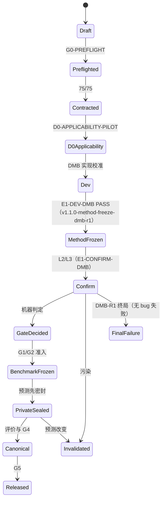

# BPI-Scan 从零重构：统计计算实验执行与证据治理规范 v2.2-draft（冻结完整性纠错）

**文件名（入库后）：** `EXPERIMENT_PROTOCOL.md`  
**生效日期：** 2026-09-03；v2.1 生效 2026-09-07；v2.2-draft 生效 2026-09-08  
**适用仓库：** `bpi-scan-rebuild`  
**目标期刊：** 《山东大学学报（理学版）》“拓扑数据分析”专题  
**计划投稿日：** 2026-10-25  
**文档状态：** 与科学总协议 v1.2-draft 对齐的可执行版（DMB-R1；冻结完整性纠错）  
**上位科学协议：** `PROTOCOL.md`（v1.2-draft，SHA256 `3b43acc35374e0e29783ea6d62014259ecfb85c04f465e316c63b6154e44215b`），来源文件 `BPI_Scan_Complete_Experiment_Protocol_v1.0_20260903.md`（v1.0 原哈希见本规范旧版）
**绑定 DMB 规格：** `docs/BPI_Scan_D_Class_DMB_Redesign_Spec_v1.0_20260907.md`，SHA256 `ab55fb534ed75e45e1152826e20722584ab3ee22f682596f2ab19e5fd706f39f`  
**替代旧规范：** `EXPERIMENT_PROTOCOL(1).md` v1.1（历史）；本文件 v2.0 为 stationary 版本（历史行，不并列作证据入口）；本文件 v2.1 为首次 DMB 行（历史行，证据治理不完整）  
**变更事件：** `AM-20260907-003`（DMB-R1 唯一 D 类路线）；`AM-20260908-001`（冻结完整性纠错）

**v2.1 生效说明（保留，历史）：** 主推断器自该版起为 `bpi_scan_dmb_bartlett_r1`（dependent Gaussian multiplier bootstrap）……PPW 仅作候选保护量，DMB 带宽 \(b_0=\max(q_0,\mathrm{ceil\_cuberoot}(M))\)，资格 \(M\ge\max(8b_0,2m_{\min}+1)\)，p 值 plus-one/`>=`/`≤0.05`，乘子 seed 用 `BPI-SCAN-V1|DMB-R1|segment|…|multiplier` + PCG64DXSM。

**v2.2-draft 纠错说明（`AM-20260908-001`，2026-09-08）：** E2 前置审计裁定 `E2_ADMISSION=NO_GO`。本规范自 v2.2-draft 起按上位协议 v1.2-draft §0.0 执行证据/治理语义澄清（方法冻结对象完整性、真实递归执行、CONFIRM ledger 标准字段、时间语义、correction 与 seal 不可改写、overlap 配对身份、smoke/formal 隔离、G0-CONTRACT 机器 test manifest 分母、D0 判定对象），并把**正式 E1 ledger/expected manifest/attempt ledger/seed manifest/node trace/统一 Gate builder**设为强制实现项。既有 v2.1 行下产生的 E1 产物（run `…8a0d4b00/…8b688985/…4f0a2bfc/…c3e06f02` 及 global-null recursion）降为开发/历史诊断，`D-FREEZE-COMPLETENESS-20260908` 污染矩阵标记 `AFFECTED_RERUN_REQUIRED`；整改顺序 R0→R4 完成、重新 method-freeze 后才产生新确认证据。

---

## 修订记录

| 版本 | 日期 | 状态 | 变更摘要 |
|---|---|---|---|
| v1.0 | 2026-08-24 | 历史 | 从通用实验模板改写为 BPI-Scan 统计计算规范 |
| v1.1 | 2026-08-24 | 被替代 | 增加缓存分类、资源约束、状态和 canonical 来源字段 |
| v2.0 | 2026-09-03 | 历史（stationary 路线） | 对齐从零重构科学协议；重建文档权威、自动块长、双确认、ledger、seal、污染矩阵、真实数据准入与投稿复现链 |
| v2.1 | 2026-09-07 | 历史（证据治理不完整） | 对齐科学协议 v1.1（`AM-20260907-003`）：主推断器改依赖高斯乘子 bootstrap；PPW 降为候选保护量；DMB 带宽/资格/seed/RNG 与目录、schema、registry、canonical、resume、污染矩阵、private seal 更新；契约 40→75（35 项 DMB） |
| **v2.2-draft** | **2026-09-08** | **现行（冻结完整性纠错）** | 对齐科学协议 v1.2-draft（`AM-20260908-001`）：按 E2 前置审计 NO_GO 落地证据/治理语义澄清（冻结对象完整性、真实递归、标准 CONFIRM ledger 字段、时间/correction/seal、overlap 配对、smoke/formal 隔离、G0 机器 test manifest、D0 判定对象）；旧 E1 产物标记 `AFFECTED_RERUN_REQUIRED`；R0–R4 整改顺序 |

---

## 0. 文档目的、术语与强制等级

### 0.1 文档目的

本规范把上位科学协议转换成可执行、可检查、可追溯的工程约束，覆盖：

1. 项目初始化；
2. 环境、源码、配置和数据冻结；
3. 随机数流与并行确定性；
4. 每个 trial 的运行、失败、重试和记录；
5. E0—E4、HASC、TSSB 的准入顺序；
6. Gate 的机器判定、失败路由和污染重跑；
7. private label 隔离、预测 seal 与揭示；
8. canonical 结果、表图、论文数字和交付包；
9. 每轮审计与最终独立复现。

本文件约束“实验怎样运行和怎样形成证据”。研究问题、数学定义、DGP、实验矩阵、统计门槛和允许主张由 `PROTOCOL.md` 约束。

### 0.2 规范词

| 词语 | 含义 |
|---|---|
| **必须** | 缺失即失败；结果不得进入下游或论文 |
| **禁止** | 一经发生即形成违规事件，按污染矩阵裁决 |
| **应当** | 默认执行；无法执行时需在事件日志中给出可验证原因 |
| **可以** | 在不改变科学输出且有记录时允许 |
| **冻结** | 内容、哈希和版本均已登记；后续不得原位更改 |
| **密封** | 冻结后另加完整性清单、SHA256 和只读标记 |
| **失效** | 证据不得用于 Gate、canonical、表图或论文 |
| **上游** | 会决定下游输入、参数、候选、随机流或评价分母的对象 |

### 0.3 时区、索引与数值约定

- 所有时间戳使用 UTC、ISO 8601，例如 `2026-09-03T12:00:00Z`；
- 代码和 ledger 内部统一使用 0-based 半开区间；
- 面向论文的表格可转为 1-based，但字段名必须带 `_0based` 或 `_1based`；
- 数值计算统一使用 IEEE-754 float64；
- `NaN`、`Inf`、`-Inf` 不得静默进入统计量；
- JSON 采用 UTF-8、键排序、无不确定空白的规范序列化；
- 路径写入 manifest 时一律保存仓库相对路径，禁止泄露本机绝对路径；
- 文件哈希统一使用 SHA256；源码树哈希按规范相对路径排序后计算。

---

## 1. 与旧规范 v1.1 的逐项对照裁定

| 旧规范条款或做法 | v2.0 裁定 | 与新实验计划对齐后的执行方式 |
|---|---|---|
| 旧目录 `BPI-Scan/` | 废止 | 新建独立仓库 `bpi-scan-rebuild`；旧仓库不进入 `PYTHONPATH` |
| `PLAN.md`、`实验计划_v2.1.md`、规范并列 | 废止 | 只保留上位 `PROTOCOL.md` 和从属 `EXPERIMENT_PROTOCOL.md`；不得再建第二份科学计划 |
| 手工维护 `INDEX.md` 主力实验指针 | 替换 | 由 ledger 和 Gate JSON 自动生成 `artifacts/status/latest_status.md` |
| 大写一级目录 | 替换 | 使用标准 Python `src/` 布局与小写目录，见 §4 |
| `requirements.txt` 锁环境 | 加强 | 使用 `pyproject.toml`、`requirements.lock`、`pip freeze`、Python build 和 BLAS 记录 |
| resolved config 用过后永不修改 | 精化 | method freeze 前按版本修订；freeze 后任何科学字段变化按 D 类变更处理 |
| argparse 禁传实验参数 | 保留并加强 | CLI 只接受配置路径、run ID、resume、dry-run 等运行控制；科学参数只来自 resolved config |
| 所有 PH 只算一次并落盘 | 修正 | 合成 trial 内共享、原则上不跨 trial 落盘；HASC/TSSB 可持久缓存 |
| scratch/canonical 两类缓存 | 保留并加强 | cache key 必含数据、预处理、窗口、PH 参数、依赖版本和源码哈希 |
| 每个实验存 `config + log + metrics + notes` | 加强 | 新增 run manifest、outer/evaluation manifests、attempt ledger、final trial ledger、seed manifest、seal 和 audit |
| Markdown 总日志可承担真实性 | 降级 | Markdown 只供阅读；机器证据以 append-only JSONL、密封 ledger 和哈希为准 |
| 总日志已有内容绝不修改 | 保留 | 纠错通过追加 correction event，不回写原事件 |
| 中间文件一律不删除 | 修正 | 证据类永久保留到评审结束；可重建 scratch cache 经 manifest 和确认后清理 |
| CPU 利用率 70%—90%，低于 70% 解释 | 替换 | E0 依据吞吐、RSS、可重复性选择 worker；利用率只作诊断指标 |
| peak RSS ≤ 75% | 对齐 | E0 候选必须 ≤24 GB；运行前后仍记录系统可用内存和 peak RSS |
| 禁止嵌套并行 | 保留 | 外层 trial 并行，单 trial 单线程；OMP/MKL/OpenBLAS 均设为 1 |
| 每轮人工打勾审计 | 加强 | 人工审阅与 `80_audit_release.py` 实际检查同时存在；自报 PASS 不构成验收 |
| `有效/无效/不确定` 三状态 | 替换 | 使用 `PASS/FAIL/PARTIAL/PIVOT/BLOCKED/INVALID/SUPERSEDED` |
| `E1-Dev / E1-Locked` | 废止 | 使用 `E1-DEV-DMB / CONFIRM-A / CONFIRM-B`（v2.1） |
| 经验 block-rule 与 `m*` 选择 | 废止 | v2.0 曾固定 `ell*=max(q0, ceil(ell_PPW))`；v2.1（DMB-R1）起 stationary/PPW 块长只作候选保护量 `ell_candidate`，不再决定校准带宽或资格 |
| `redesign → PI-Scan` | 废止 | G1 失败曾允许一次 dependent multiplier bootstrap redesign；该 redesign 已在 v2.1 签署生效，此后无第二次方法级 redesign |
| 旧阶段中 `E3 HASC` | 废止 | 新顺序为 E0、E1、E2、E3 多变点、E4 敏感性、HASC、TSSB |
| `E2–E5 frozen` 的旧编号 | 废止 | 以新 `experiment_id` 和 Gate registry 为准 |
| segment identity 派生置换种子 | 保留并精化 | trial 流与 segment 流分层 SHA256 派生，见 §9 |
| canonical 只有 CSV | 加强 | 同时生成 Parquet 与 CSV；二者内容一致并分别哈希 |
| canonical 来源字段较少 | 加强 | 采用完整 trial schema、run seal、数据/配置/源码/seed/provenance 链 |
| 图表由脚本生成 | 保留并加强 | 每张表图附数据副本、provenance JSON、SHA256；静态扫描禁止硬编码论文结果 |
| 真实数据没有严格 label firewall | 新增 | HASC private 预测进程禁止访问标签，预测先 seal，随后独立评价 |
| TSSB/HASC 准入可人工解释 | 替换 | 80% 阈值按精确比例执行；差一条也不改判定 |
| 未规定 confirm 缺失容忍 | 新增 | 任一确认性 cell 最终缺失率超过 0.5% 时整格失败 |
| 未规定观察后提前停止 | 新增禁止 | outer MC 样本量启动前锁定，运行中不得因结果稳定而提前结束 |
| 未规定变化影响矩阵 | 新增 | 每次代码/配置/数据变化均生成 contamination matrix |
| 未隔离旧代成果 | 新增强制 | 旧代码、配置、cache、ledger、预测、canonical、图表和数字全部排除 |

### 1.1 保留的旧规范内核

以下原则继续有效：

- Gate 假设先登记、标准先冻结、结果后产生；
- 数据和代码必须可溯源；
- 正式实验必须有 clean commit；
- 运行目录不可覆盖；
- 事件和失败必须如实记录；
- 未通过上游 Gate 时不得越级进入受其约束的下游；
- 表图必须由权威结果文件自动生成；
- 一轮结束后必须审计。

---

## 2. 文档体系、权威顺序与单一真相源

### 2.1 根目录文档

| 文件 | 唯一职责 | 是否人工修改 |
|---|---|---:|
| `PROTOCOL.md` | 科学总协议：假设、公式、矩阵、Gate、主张边界 | 仅依修订流程 |
| `EXPERIMENT_PROTOCOL.md` | 本规范：执行、证据、冻结、审计、交付 | 仅依修订流程 |
| `CHANGELOG_PROTOCOL.md` | 两份协议的 append-only 修订事件 | 只追加 |
| `CLAIM_EVIDENCE_MATRIX.md` | 论文主张与 Gate/表图/证据映射 | Gate 后更新 |
| `MIGRATION_LOG.md` | 旧算法人工迁移记录；无迁移时保留空表 | 只追加 |
| `README.md` | 安装、最小重现、入口说明 | 可更新，不能改变协议 |

禁止恢复旧 `PLAN.md`、`实验计划_v2.1.md` 或另一份平行科学方案。旧文档只可进入仓库外的 forensic archive，不能作为运行输入。

### 2.2 冲突优先级

发生冲突时按以下顺序裁决：

1. 带日期、范围、理由和批准记录的已签名协议修订事件；
2. `PROTOCOL.md` 的科学定义；
3. `EXPERIMENT_PROTOCOL.md` 的执行定义；
4. 已冻结的机器配置；
5. 实现代码；
6. README、人工日志、报告和论文草稿。

若代码与 1—3 项冲突，代码输出立即标记 `INVALID_PROTOCOL_MISMATCH`。若机器配置与 `PROTOCOL.md` 冲突，运行应在 preflight 阶段拒绝启动。

### 2.3 镜像字段一致性

本规范为便于执行会镜像少量科学字段，例如样本量、`B` 和 Gate 阈值。所有镜像字段必须在 `configs/protocol_contract.yaml` 中带：

```yaml
field_id: e1_confirm.outer_trials_per_cell
value: 2000
mirror_of: "PROTOCOL.md#14.3"
protocol_version: "1.0"
```

`00_preflight.py` 通过冻结的 contract snapshot 校验镜像值。任何不一致均阻止运行。科学值的修改只能先修订 `PROTOCOL.md`，随后同步 contract 和本规范版本。

### 2.4 不可接受的证据来源

以下内容不得单独支持论文数字或 Gate：

- 控制台截图；
- 手工录入的 Markdown 表格；
- 未带 config/data/source hash 的 CSV；
- dirty worktree 下的 CONFIRM 或 PRIVATE 输出；
- 旧仓库、旧压缩包或旧结果中的数字；
- 只声明“审计通过”但没有实际检查项、输入哈希和退出码的报告；
- 从 private/TSSB 标签观察后产生的参数选择；
- 被污染矩阵标为需要重跑、失效或上游阻塞的输出。

---

## 3. 版本、修订和冻结制度

### 3.1 版本号

项目使用语义化版本：

- `MAJOR`：科学目标、主统计量、resampler/DMB 乘子机制、主数据或主 Gate 发生变化；
- `MINOR`：预注册实验矩阵、基线、指标或工程协议增加；
- `PATCH`：不改变定义的实现修复或文字澄清。

v2.0→v2.1 属方法级（D 类）升级：resampler 机制由 stationary 索引块长改为 dependent Gaussian multiplier（方法 ID `bpi_scan_dmb_bartlett_r1`）。PATCH 是否需要重跑由实际影响决定；版本号小不代表影响小。

### 3.2 协议修订事件必填字段

```text
amendment_id, created_at_utc, author, approved_by,
parent_protocol_version, target_sections, change_class,
old_text_hash, new_text_hash, rationale,
evidence_seen_before_change, affected_experiments,
rerun_required, new_protocol_version
```

任何修订均追加到 `CHANGELOG_PROTOCOL.md` 和 `artifacts/audit/amendments.jsonl`。原协议文件随 Git 历史保留。

### 3.3 允许的修订窗口

| 时点 | 允许变更 | 处理 |
|---|---|---|
| G0 前 | 文字、工程骨架、尚未运行的配置 | 正常版本化 |
| DMB-R1 修订/实现期（当前） | 本规范 v2.1 与科学协议 v1.1 对齐；DMB 实现缺陷、计算可行性 | 记录全部 DEV 证据；状态 `PRE_METHOD_FREEZE_BLOCKED` |
| E1-DEV-DMB 后、CONFIRM 前 | 唯一 method-freeze 修订 | 打 `v1.1.0-method-freeze-dmb-r1` |
| CONFIRM 后 | 展示/评价 bug；科学输出变更按污染矩阵重跑 | 禁止结果驱动调参；DMB-R1 失败后禁止再改核/带宽/中心化/资格 |
| benchmark freeze 后 | private 参数、comparator、eligibility 定义均锁死 | 改变预测即 private 整体失效 |
| results freeze 后 | 排版与非数值文字 | 数字变化需撤销 freeze |

### 3.4 冻结标签

| Git tag | 准入证据 |
|---|---|
| `v0.1.0-contracts` | G0-PREFLIGHT 和 contract tests 通过（historical 基线） |
| `v1.0.0-method-freeze` | `PRE_FREEZE_SUPERSEDED`（stationary 路线；不并列作正式证据入口） |
| `v1.1.0-method-freeze-dmb-r1` | **唯一正式 method-freeze**：规格入库+协议 v1.1/v2.1+75/75 契约+D0-APPLICABILITY+E1-DEV-DMB PASS、CONFIRM 前、工作区 clean（绑定规格 §17） |
| `v1.1.0-benchmark-freeze` | HASC public-dev/val 完成（仅 D0-HASC PASS 后），全部参数和 comparator 冻结 |
| `v2.0.0-results-freeze` | canonical、表图、Gate 和 claim matrix 一致 |
| `v2.1.0-submission` | 论文、补充材料、复现包通过 G5 |

每个 tag 需有 annotated message，至少写协议版本、commit、source tree SHA256、config registry SHA256 和审计报告路径。

---

## 4. 仓库结构与目录职责

```text
bpi-scan-rebuild/
├─ README.md
├─ PROTOCOL.md
├─ EXPERIMENT_PROTOCOL.md
├─ CHANGELOG_PROTOCOL.md
├─ CLAIM_EVIDENCE_MATRIX.md
├─ MIGRATION_LOG.md
├─ EXPERIMENT_LOG.md
├─ pyproject.toml
├─ requirements.lock
├─ configs/
│  ├─ protocol_contract.yaml
│  ├─ schema.json
│  ├─ templates/base.template.yaml       # 不可运行
│  ├─ resolved/e0_geometry.yaml
│  ├─ resolved/e0_compute.yaml
│  ├─ resolved/d0_applicability.yaml
│  ├─ resolved/e1_dev.yaml
│  ├─ resolved/e1_confirm.yaml
│  ├─ resolved/e1_overlap.yaml
│  ├─ resolved/e1_dependence.yaml
│  ├─ resolved/e2_smoke.yaml
│  ├─ resolved/e2_formal.yaml
│  ├─ synthetic.yaml
│  ├─ e1_calibration.yaml
│  ├─ e3_multiple_cp.yaml
│  ├─ e4_sensitivity.yaml
│  ├─ hasc.yaml
│  └─ tssb.yaml
├─ src/bpi_scan/
│  ├─ preprocessing.py
│  ├─ embedding.py
│  ├─ windows.py
│  ├─ persistence.py
│  ├─ surfaces.py
│  ├─ block_length.py            # PPW 仅作候选保护量（ell_candidate）
│  ├─ inference/                 # v2.1：DMB-R1 主推断器（X01）
│  │  ├─ __init__.py
│  │  ├─ dependent_multiplier.py # 节点检验主入口（bandwidth/candidates/eligibility/p-value）
│  │  ├─ multipliers.py          # Bartlett 乘子构造（external_iid_padding，PCG64DXSM）
│  │  ├─ bridge.py               # 部分和与 Brownian-bridge 校正
│  │  └─ naive.py                # 机制对照全排列
│  ├─ stationary_bootstrap.py    # historical 套件；不再进入 DMB method-freeze 通过条件
│  ├─ scan.py
│  ├─ segmentation.py
│  ├─ synthetic.py
│  ├─ datasets.py
│  ├─ baselines.py
│  ├─ metrics.py
│  ├─ seeds.py
│  ├─ ledger.py
│  └─ provenance.py
├─ tests/
│  ├─ test_dmb_contracts.py      # DMB 新增 35 项契约（0 skip）
│  └─ historical/                # 原 40 项中的 stationary 专属套件（执行但不作通过条件）
├─ scripts/
│  ├─ 00_preflight.py
│  ├─ 01_e0_contracts.py         # 75 项契约（40 historical + 35 DMB）
│  ├─ 02_e0_compute.py
│  ├─ 10_e1_dev.py               # E1-DEV-DMB
│  ├─ 11_e1_confirm.py           # E1-CONFIRM-DMB
│  ├─ 12_e1_overlap.py
│  ├─ 13_e1_dependence.py        # E1-DEPENDENCE（DMB 诊断，关闭审计 G1 缺口）
│  ├─ 20_e2_power.py
│  ├─ 30_e3_multiple_cp.py
│  ├─ 40_e4_sensitivity.py
│  ├─ 50_hasc_manifest.py
│  ├─ 51_hasc_dev.py
│  ├─ 52_hasc_val.py
│  ├─ 53_hasc_private_predict.py
│  ├─ 54_hasc_private_evaluate.py
│  ├─ 60_tssb.py
│  ├─ 70_build_canonical.py
│  ├─ 71_build_tables.py
│  ├─ 72_build_figures.py
│  ├─ 80_audit_release.py
│  └─ 81_reproduce_smoke.py
├─ data/
│  ├─ raw/                    # gitignored
│  ├─ manifests/
│  └─ labels_private/         # 与预测进程隔离
├─ cache/                     # gitignored
├─ runs/                      # 每个 run 独立且不可覆盖
├─ artifacts/
│  ├─ audit/
│  ├─ canonical/
│  ├─ tables/
│  ├─ figures/
│  ├─ seals/
│  └─ status/
└─ docs/
   ├─ method_spec.md
   ├─ resampling_spec.md
   ├─ metric_spec.md
   ├─ baseline_spec.md
   ├─ data_spec.md
   ├─ audit_spec.md
   ├─ BPI_Scan_D_Class_DMB_Redesign_Spec_v1.0_20260907.md  # 绑定 DMB-R1 技术规格（v2.1）
   └─ dmb_r1_patch_plan.md                                   # v1.1/v2.1 补丁与测试清单
```

### 4.1 目录约束

| 位置 | 强制约束 |
|---|---|
| `configs/` | 只保存受 schema 校验的科学配置；正式 run 使用 resolved copy |
| `src/` | 不读取标签路径、不含实验结果常数、不依赖旧仓库；`inference/` 内 DMB 实现必须通过 35 项专项契约 |
| `scripts/` | 只做编排；核心算法必须位于包内并接受测试 |
| `data/raw/` | 原始数据不进 Git；manifest 和下载说明进 Git |
| `data/labels_private/` | private 预测进程不可见 |
| `cache/` | 任何命中均需验证完整 cache key 和 payload hash |
| `runs/` | 每次启动创建新目录；禁止原位覆盖、复制成“新结果” |
| `artifacts/canonical/` | 论文数值唯一入口；只能由 builder 生成；只接受 DMB 命名空间行 |
| `artifacts/tables/figures` | 只能读取 canonical；每项附 provenance |
| `artifacts/seals/` | 保存 run、预测、结果包的 SHA256 清单 |
| `docs/` | 对公式、指标和算法给出可测试规格；不得包含另一套参数；DMB 规格为绑定文档，正文冲突以其为准 |

### 4.2 旧项目隔离

新仓库初始化时必须通过以下检查：

- `PYTHONPATH` 不含旧仓库；
- Git tracked files 不含旧 `SRC/`、配置、ledger、cache、预测、canonical、图表；
- 全仓静态扫描不含旧绝对路径、旧 commit、旧 run ID；
- 新论文和表图的数据来源不含旧 SHA256；
- 旧代码若确需迁移，先写独立规格与慢速参考实现，再做逐值一致性测试；
- 每次迁移在 `MIGRATION_LOG.md` 记录原对象、人工重写范围、测试和批准结果。

旧材料只承担失败案例和测试启发功能。旧数字全部视为历史背景，不能进入新证据链。

---

## 5. 证据层级与用途

| 层级 | 名称 | 允许操作 | 可否支持论文主结果 |
|---|---|---|---:|
| L0 | 单元测试与确定性微例 | 修代码、补测试 | 否；可说明正确性 |
| L1 | DEV | 在唯一修订窗口内修规格/实现 | 否 |
| L2 | CONFIRM | 参数和方法冻结；只允许按规则重跑 | 是 |
| L3 | SENSITIVITY | 主配置冻结；只跑预注册变化 | 是，标注敏感性 |
| L4 | REAL-VAL | 禁止回到开发网格 | 是 |
| L5 | REAL-PRIVATE | 全冻结、预测先密封、随后揭示 | 是 |

### 5.1 证据对象的五个条件

结果只有同时满足以下条件才有资格进入 canonical：

1. **身份完整：** experiment、cell、trial、method、batch 均有稳定 ID；
2. **来源完整：** data/config/source/environment/seed 均有 SHA256 或稳定标识；
3. **数量完整：** 预期 outer units、方法级 evaluations、实际完成、失败、重试和缺失可核对；
4. **时间完整：** 冻结、运行、seal、评价顺序可验证；
5. **状态有效：** 未被污染矩阵标记为失效、需重跑或上游阻塞。

### 5.2 结论状态

| 状态 | 含义 | 下游处理 |
|---|---|---|
| `PASS` | 全部预注册判据通过 | 按协议进入下游 |
| `FAIL` | 至少一个必要判据失败 | 执行固定失败路由 |
| `PARTIAL` | 仅支持收缩后的主张 | 更新 claim matrix |
| `PIVOT` | 启动预注册替代路线 | 原结果标记 `SUPERSEDED` |
| `BLOCKED` | 上游 Gate、数据或审计未完成 | 不得启动受约束实验 |
| `INVALID` | 协议、实现、来源或完整性违规 | 永久退出证据链 |
| `SUPERSEDED` | 被已登记的新版本整体替代 | 仅保留历史审计用途 |

---

## 6. 实验状态机与强制顺序



### 6.1 阶段准入表

| 阶段 | 必须已经具备 | 必须产出 | 禁止行为 |
|---|---|---|---|
| Draft | 协议与仓库骨架 | 代码、schema、测试骨架 | 生成可被误用的正式结果 |
| Preflight | 干净环境和 clean Git | 环境/硬件/数据/源码报告 | 忽略警告继续 |
| Contracts | preflight 通过 | 75/75 报告（40 historical + 35 DMB） | skip、xfail 规避 |
| D0-APPLICABILITY | 75/75 契约通过 | 300 条适用性输出（无 p 值） | 计算 p 值、调整资格/带宽后重试 |
| E0 | contracts 通过 | geometry/compute（D0 前置为契约+几何） | 读取功效结果选 worker |
| E1-DEV-DMB | D0-APPLICABILITY PASS | DEV ledger、审计、冻结报告 | 用 DEV 支持论文 size；调核/带宽/中心化 |
| Method freeze | E1-DEV-DMB PASS | tag `v1.1.0-method-freeze-dmb-r1`、hash、resolved configs | 第二次方法级调整 |
| CONFIRM（DMB） | method freeze tag | 两批 sealed ledger | 观察结果后提前停 |
| Gate decision | cell 完整 | JSON + Markdown 判定 | 人工改阈值、挑批次 |
| Benchmark dev/val | G1 通过、loader 测试通过 | frozen benchmark config | 使用 private/TSSB 标签调参 |
| Private predict | benchmark freeze | predictions + eligibility + seal | 标签可见、揭示后重选 comparator |
| Private evaluate | prediction seal 验证 | metrics + G4 | 修改预测文件 |
| Canonical | 所有拟报告 run sealed | CSV/Parquet + provenance | 手工抄数 |
| Release | canonical 完成 | 表图、claim matrix、G5 | 跳过空目录复现 |

### 6.2 上游阻塞关系

- G0 未通过：任何 MC 均阻塞；
- D0-APPLICABILITY-PILOT 未通过（无实现 bug）：`DMB_R1_FAIL_APPLICABILITY`，可靠推断主线终止；
- D0-HASC 未通过（2026-09-13 截止）：HASC 撤主外部验证，TSSB 承担；
- G1-CALIBRATION-DMB 未通过：E2 可保留方法诊断用途，private 主线阻塞；无实现 bug 则 `FINAL_METHOD_FAILURE_DMB_R1`；
- G2 两个 primary 均低于停止线：真实数据不得用于“挽救”统计量；
- G3 失败：多变点主张删除，单变点路线仍可继续；
- HASC 或 TSSB 单独低于 eligibility：该数据集降入适用性补充；
- 两个外部数据集均未达主文准入：专题投稿主线停止；
- G5 未通过：禁止投稿。

---

## 7. 配置制度与无隐藏默认值

### 7.1 配置来源

每次运行只能读取一个 `configs/resolved/*.yaml` 入口。该文件必须自足、无继承、无环境变量占位、无隐式科学默认；`configs/templates/base.template.yaml` 只作字段模板，validator 必须拒绝直接运行它。

必须记录：

```text
protocol_version, experiment_id, phase, level,
dataset_id, dataset_version, data_manifest_sha256,
method_id, feature_spec, window_spec, ph_spec, surface_spec,
calibration_spec, candidate_spec, scan_spec, recursion_spec,
metric_spec, alpha, B, outer_trials, batch_id,
seed_namespace, worker_count, thread_limits,
expected_outputs, code_commit
```

v2.1 方法配置至少含绑定规格 §12 全部字段（`method.id= bpi_scan_dmb_bartlett_r1`、`multiplier.*`、`eligibility.*`、`test.*`）。任一字段缺失、CLI 覆盖或 config hash 不一致时 run 启动失败。

### 7.2 Schema 规则

- 未声明字段：拒绝；
- 缺少必填字段：拒绝；
- 数值单位必须写入字段名或 schema description；
- 枚举值大小写固定；
- `alpha=0.05`、p 值 `>=` tie、拒绝 `p<=alpha` 由 schema 与测试双重锁定；
- `B`、outer trial 数和 Gate 阈值由 experiment registry 校验；
- `config_sha256` 对规范化 resolved config 计算；
- 正式运行将 resolved config 复制到 run 目录并设只读；
- DMB 带宽规则（`bandwidth_rule: max_q0_ceil_cuberoot_M`、`bandwidth_scope: full_series_fixed_across_recursion`）、边界（`external_iid_padding`）、中心化（`node_global_mean`）、桥接（`bridge: true`）、共同乘子与 RNG（`PCG64DXSM`）进入 schema 枚举并由契约测试锁定。

### 7.3 CLI 允许项

入口只允许以下类型的运行控制：

```text
--config PATH
--run-id ID
--resume RUN_DIR
--dry-run
--audit-only
```

worker 数应来自冻结配置。任何 `W`、`s`、`B`、seed、网格、带宽、DMB `b0`/核/中心化/资格、候选、阈值、数据 split 或方法选择参数均禁止在命令行临时覆盖。

### 7.4 配置冻结

启动正式 run 前生成：

```text
runs/<run_id>/config.source.yaml
runs/<run_id>/config.resolved.yaml
runs/<run_id>/config.sha256
```

三者创建后不可修改。需要变化时创建新 config 版本和新 run。

`config_sha256` 的输入为 YAML 解析后的规范 JSON：键按 Unicode code point 排序；UTF-8；LF；整数、布尔和字符串保持类型；float 按 Python float64 round-trip 十进制表示；禁止 NaN/Inf；不包含注释和源文件路径。

---

## 8. 环境、主机与预检

### 8.1 主机基线

| 项目 | 冻结基线 |
|---|---|
| OS | Windows 11 Pro |
| CPU | Intel i5-12600KF，10 核/16 线程 |
| RAM | 31.81 GB |
| GPU | RTX 4070 SUPER；主实验不使用 |
| Python | 3.12.10 |
| 主计算路线 | CPU Ripser |

### 8.2 环境约束

- 新建干净虚拟环境，不继承全局包集合；
- 依赖同时写入 `pyproject.toml` 和完全锁定的 `requirements.lock`；
- 保存 `pip freeze`、Python build、OS build、CPU、内存和 BLAS 后端；
- 正式运行不得自动升级包；
- 容器若用于复现，镜像必须 pin digest；仅写 tag 不够；
- `arch` 只承担 PPW 开发期黄金值交叉验证，版本进入 lock；主运行使用项目内测试实现；
- **交叉验证版本锁定（G4 关闭）**：`gudhi==3.13.0`（契约第 8 项/E0-GEOMETRY Ripser 交叉）、`arch==8.0.0`（PPW 黄金值）进入 `requirements.lock`；
- **RNG 可复现**：DMB 乘子使用 `numpy.random.Generator(numpy.random.PCG64DXSM(seed))` 且每 replicate 只调用一次 `standard_normal(n+b0-1, dtype=float64)`；NumPy 版本锁入 lock；禁止全局 `np.random`、Python `random`、GPU RNG 或系统熵源（绑定规格 §10.3）。

初始核心版本镜像上位协议：

```text
python==3.12.10
numpy==2.2.6
scipy==1.15.3
pandas==2.3.3
scikit-learn==1.7.2
statsmodels==0.15.0
ripser==0.6.15
persim==0.3.8
ruptures==1.1.10
changeforest==1.2.1
claspy==0.2.8
joblib==1.5.3
pytest==9.1.1
PyYAML==6.0.3
```

安装解析后若实际版本不可获得，必须在任何实现前修订 lock 和兼容性记录，禁止由包管理器静默替换。

### 8.3 `00_preflight.py` 输出

```text
environment.json
hardware.json
package_lock_sha256.txt
pip_freeze.txt
data_manifest.csv
source_tree_sha256.txt
config_registry_sha256.txt
preflight_checks.json
preflight_report.md
```

G0-PREFLIGHT 全部条件：

- 核心包全部可导入；
- Python 和锁版本一致；
- 主盘可用空间 ≥25 GB；
- 可用空间 <15 GB 时脚本拒绝启动新 run；
- BLAS 线程限制生效；
- Git 工作区 clean；
- 当前 commit 可解析；
- 源码树 hash 可重复；
- seed 重放一致；
- 配置全部通过 schema；
- 上位协议 hash 与本文件头一致；
- 全仓不含旧项目路径；
- private label firewall 测试环境可建立。

任一检查的实际布尔值为 false 时，报告总状态必须为 FAIL。报告生成器不得在检查执行前写入 PASS 占位。

### 8.4 源码树哈希算法

源码范围固定为 Git tracked 的 `src/`、`scripts/`、`tests/`、`configs/`、两份协议、lock 文件及 `pyproject.toml`。路径转为 POSIX 相对路径并按 UTF-8 字节序排序。每项写入：

```text
relative_path + NUL + sha256(file_bytes) + LF
```

再对拼接字节计算总 SHA256。仓库必须通过 `.gitattributes` 固定文本文件 `eol=lf`。CONFIRM/PRIVATE 要求 freeze source manifest 覆盖范围内的 `git status --porcelain -- <frozen-targets>` 为空；运行中自然增长的 run、registry、Gate、preflight 与 freeze attestation 位于该 source scope 外，仍分别由 seal/append-only hash 约束。

---

## 9. 随机数流、trial 身份与并行确定性

### 9.1 根种子

| 命名空间 | uint64 根种子 |
|---|---:|
| DEV | 14624430889863187540 |
| CONFIRM-A | 7652214086111030190 |
| CONFIRM-B | 10714481306926991779 |
| POWER | 6338124067242535181 |
| REAL-SPLIT | 8824389276957873083 |
| RESAMPLING | 4023015224203201134 |
| FIGURES | 4871402478146422143 |

根种子由字符串 `BPI-SCAN-V1|CONTEXT` 的 SHA256 前 8 字节按 big-endian 解释获得。根种子常量进入单元测试。

### 9.2 Trial 派生

对 experiment (e)、cell (c)、replicate (r) 和 stream (s)：

\[
\operatorname{seed}(e,c,r,s)=
\operatorname{uint64}\left(
\operatorname{SHA256}[\texttt{BPI-SCAN-V1}|e|c|r|s]_{0:8}
\right).
\]

其中 \(e\) 使用完整 namespaced ID：`<root_namespace>/<experiment_id>/<batch_id>`。因此 CONFIRM-A 与 CONFIRM-B 即使 replicate 编号相同也不会共享随机流。

`s` 至少包括：

```text
data
subsample
tie
metric_bootstrap
```

DMB 乘子流不占用 `resample` 命名空间，而使用绑定规格 §10 的独立 `DMB-R1` segment（见 §9.3）。数据生成、持久点抽样、并列处理、区间 bootstrap 与乘子随机流不得共享流。

### 9.3 Segment 派生

**DMB 乘子 per-node/per-replicate seed（v2.1）：** 对完整 namespaced `experiment_id`、`cell_id`、`replicate_id`、`method_id`、全局节点端点 `a,b` 与 bootstrap replicate `u=0,...,B-1`，构造无前导零的十进制 UTF-8 字符串：

```text
BPI-SCAN-V1|DMB-R1|segment|<experiment_id>|<cell_id>|<replicate_id>|<method_id>|<a>|<b>|<u>|multiplier
```

seed 取 SHA256 前 8 字节按 big-endian 解释的 uint64。每个 replicate 单独派生 seed；每个 seed 只初始化一次 `numpy.random.Generator(numpy.random.PCG64DXSM(seed))` 并只调用一次 `standard_normal(n+b0-1, dtype=float64)`。batch size、worker 数、resume 次数、节点队列实现与其他 replicate 的存在均不得改变乘子序列。trial ledger 保存根节点 seed 派生输入与 `multiplier_seed_manifest_sha256`；完整 per-node/per-bootstrap seed 清单以压缩 Parquet 或 JSONL 保存（不要求主 trial 行展开 999 字段）。

历史 stationary segment 规则（`…|resample`，含 `method_id|a|b`）保留作 historical 套件文档，不再生成 DMB 乘子。

### 9.4 Outer ID、trial ID 与 attempt ID

```text
outer_id = SHA256(experiment_id|cell_id|batch_id|replicate_id|dgp_config_sha256)
trial_id = SHA256(outer_id|method_id|method_config_sha256)
attempt_id = trial_id + ":a" + retry_count
```

- `outer_id` 标识一条外层 Monte Carlo 数据或一条真实序列；同一数据上的各方法共享 `outer_id`；
- `trial_id` 标识某个方法在该 outer unit 上的一次冻结评价；
- final trial ledger 中 `trial_id` 必须唯一；
- attempt event ledger 可以包含同一 `trial_id` 的多个 attempt，但 `attempt_id` 必须唯一；
- retry 使用完全相同的 seed、配置和科学输入；
- 因 bug 修复产生的重跑必须进入新 config/source hash 和新 run，不可伪装为 retry；
- resume 时除原字段外，还必须校验 `multiplier_seed_manifest_sha256` 与中断前一致（X07；绑定规格 §10.4）。

所有 paired comparison 按 `outer_id` 连接；禁止按行号或完成顺序配对。文中“36,400 outer trials”指 36,400 个 outer unit，ledger 方法级行数由各实验的 method registry 决定。

### 9.5 并行规则

- Windows multiprocessing 采用 `spawn`；
- 所有脚本入口置于 `if __name__ == "__main__":`；
- 只在 outer trial 或独立 series 层并行；
- 单 trial 内 `OMP_NUM_THREADS=1`、`MKL_NUM_THREADS=1`、`OPENBLAS_NUM_THREADS=1`；
- worker 数由 E0-COMPUTE 在 `{1,4,8,12}` 中冻结；
- 1、4、8 worker 的科学输出 hash 必须一致，运行时间字段除外；
- worker 不得共同写一个可变 CSV；每个 worker 写独立 append-only shard，封存时排序合并。

---

## 10. 数据治理、manifest 与标签隔离

### 10.1 通用数据 manifest

每个数据对象至少登记：

```text
dataset_id, dataset_version, source_url, license,
retrieved_at_utc, upstream_commit, relative_path,
file_size_bytes, sha256, n_series, series_id,
subject_or_family, n_samples, n_channels,
label_available, split, preprocessing_version
```

下载、解压、重命名、清洗和 split 必须由脚本完成或生成机器可读操作清单。原始文件 hash 与清洗后文件 hash 分开保存。

### 10.2 合成数据

- DGP 的全部参数进入 resolved config；
- replicate 的数据由 `seed_data` 重新生成；
- 合成原始序列原则上不长期落盘；
- 每格前 20 个 audit trial 保存原始数据、中间点云、diagram、surface 和统计量；
- DGP invariant 在正式运行前通过；
- CONFIRM-A 与 CONFIRM-B 使用独立根命名空间。

### 10.3 HASC（v2.1：BLOCKED_DATA_IDENTITY）

- **状态**：`BLOCKED_DATA_IDENTITY / NO_ANALYSIS_ALLOWED`（`AM-20260907-001`）；“250 条/50 Hz/8 名受试者”是未验证历史派生子集目标，须经 **D0-HASC 门**（8 项验收，截止 2026-09-13T23:59Z）验收后才允许任何正式分析（D0 细则见 `docs/data_spec.md`）；
- `50_hasc_manifest.py` 在读取变点标签前按 D0 验收后冻结的 manifest 核验：来源、许可、文件 SHA256、subject、序列长度、通道、缺失率和标签格式；
- 公开 hc2011 RealWorld/SampleData 不得作为当前身份替代（按 E 类变更另立身份除外）；旧缓存仅可作传输副本，字节哈希/派生链验证后方可进入本仓库；
- 官方 public 进入 public-dev/public-val，按 subject 和 `REAL-SPLIT` 固定划分；
- 官方 private 作为最终密封评估；
- private 原始特征与 private labels 存在不同目录；
- `53_hasc_private_predict.py` 的进程环境不提供 label path；
- private eligibility 由无标签特征、冻结配置和算法状态决定（DMB 资格见 §19.4）；
- 揭示后不得改变参数、comparator、eligibility 或预测。

### 10.4 TSSB

- 固定官方仓库 commit、序列 manifest 和 family manifest；
- TSSB 属构造型公开基准，正文必须披露这一属性；
- benchmark-provided window size 可以使用，但必须披露任务先验；
- 标签不得用于方法参数选择；
- eligible series 比例与 eligible family 比例均须达到 80% 才进入主文真实数据表；
- 任一比例低于 80% 时，结果进入 applicability/common-support 补充表；
- 比例按精确分子/分母判定，不四舍五入，不设置“一条序列例外”。

### 10.5 标签防火墙测试

private 预测脚本必须满足：

1. label 文件路径不在参数、环境变量或 config 中；
2. mock label 文件的打开请求会触发测试失败；
3. 预测日志中不出现 label hash、真实变点数或评价指标；
4. 预测文件 seal 时间早于评价进程首次读取标签时间；
5. 评价脚本只读 sealed predictions，不能调用预测算法。

---

## 11. 运行目录、不可覆盖与原子写入

### 11.1 Run ID

格式固定为：

```text
YYYYMMDDTHHMMSSZ_<experiment_id>_<config8>_<uuid8>
```

示例：

```text
20260916T080000Z_E1_CONFIRM_A_a12bc34d_91ef27a0
```

run 目录已存在时启动必须失败。`--resume` 只能指向同一 run，并先验证 manifest、config、source 和 seed hash。

### 11.2 Run 目录内容

```text
runs/<run_id>/
├─ run_manifest.json
├─ config.source.yaml
├─ config.resolved.yaml
├─ config.sha256
├─ evidence/
│  ├─ expected_outer_manifest.json
│  ├─ seed_manifest.jsonl
│  └─ seed_manifest.sha256
├─ environment.json
├─ source_tree_sha256.txt
├─ command.json
├─ events.jsonl
├─ attempts/
│  └─ worker-<id>.jsonl
├─ ledger/
│  ├─ final_trial_ledger.jsonl
│  ├─ final_trial_ledger.parquet
│  ├─ node_trace.jsonl
│  ├─ node_trace.parquet
│  └─ multiplier_seed_manifest.parquet
├─ audit_samples/
├─ metrics/
├─ stdout/
├─ failures/
├─ audit/
└─ seal.json
```

### 11.3 原子写入

- 结构化文件先写同目录临时文件，`fsync` 后原子 rename；
- 完成标志只能在 payload 写完并重新计算 hash 后生成；
- 异常退出留下的临时文件不得被视为有效输出；
- resume 时先核验已完成 trial 的 payload hash；
- seal 创建后 run 目录的科学文件不得改写；
- Windows 只读属性仅作辅助，真实性以 hash 和 Git/manifest 记录为准。

### 11.4 Run manifest

至少包含：

```text
run_id, experiment_id, level, batch_id,
protocol_sha256, execution_protocol_sha256,
git_commit, dirty, source_tree_sha256,
config_sha256, data_manifest_sha256,
environment_sha256, seed_manifest_sha256,
expected_outer_count, expected_evaluation_count, expected_method_count,
started_at_utc, finished_at_utc,
host_id_hash, worker_count, status,
parent_run_id, supersedes_run_id
```

绝对路径、用户名、设备序列号不得进入对外交付 manifest。`host_id_hash` 使用项目生成的匿名稳定标识。

### 11.5 Run seal 算法

seal 前先停止所有 writer。按 POSIX 相对路径排序，对 run 目录内除 `seal.json`、临时文件和 OS 元数据之外的每个文件记录：路径、字节数、SHA256。规范序列化完整文件清单并计算 `manifest_sha256`，随后原子写入：

```text
run_id, sealed_at_utc, file_count, total_bytes,
manifest_sha256, files[], sealer_commit,
audit_status, audit_report_sha256
```

seal 后任何纳入清单的文件改变均使验证失败。重新密封只能产生新 run 或明确的 superseding seal 事件，不能删除旧 seal。

---

## 12. 缓存、存储和资源控制

### 12.1 缓存分类

| 类型 | 内容 | 保留规则 |
|---|---|---|
| in-memory | 合成 trial 的点云、PH、表面 | trial 结束释放 |
| audit cache | 每格前 20 个完整审计 trial | 作为证据保留 |
| real canonical cache | HASC/TSSB 的 PH 与固定特征 | 提交和评审期间保留 |
| scratch cache | 可重建临时对象 | 有 manifest 后可清理 |

### 12.2 Cache key

任何持久 cache key 必须覆盖：

```text
dataset_id + data_sha256 + series_id
+ preprocessing_spec_sha256
+ W + s + d + delta
+ distance_spec_sha256
+ ph_spec_sha256 + ripser_version
+ surface_spec_sha256
+ source_tree_sha256
```

任何组成字段变化都必须 cache miss。payload 另存 SHA256；命中前先校验。

### 12.3 清理规则

- `runs/`、sealed ledger、audit sample、canonical、seals 和 release 包不得清理；
- scratch cache 只有在生成 manifest、验证可重建命令、确认无 run 引用后才能清理；
- 损坏 cache 移入 `cache/quarantine/` 并记录事件，不能原位覆盖后假装同一对象；
- 原始数据依许可保存，不得把受限数据放入公开交付包；
- 评审结束前不得清理支撑已投稿数字的证据对象。

### 12.4 资源规则

- 正式运行前目标盘可用空间 ≥25 GB；
- 运行中低于 15 GB 时停止派发新 trial，已在运行的 trial 安全结束；
- E0 worker 候选的 peak RSS 必须 ≤24 GB；
- 完整算法基线单序列上限 30 分钟、单方法全数据上限 24 小时、单进程内存上限 16 GB；
- 超时和 OOM 进入失败率分母，不得静默排除；
- 大于 10 分钟的任务显示完成 trial/总 trial、elapsed、ETA、成功/失败数和吞吐；
- heartbeat 至少每 60 秒写一次 `events.jsonl`；
- GPU 不参与主结果，也不作为 Gate 准入条件。

---

## 13. 可观测性、失败与重试

### 13.1 事件日志

`events.jsonl` 每行是不可变事件，至少包含：

```text
event_id, created_at_utc, run_id, event_type,
trial_id, attempt_id, worker_id, severity,
message_code, payload_sha256
```

允许的关键 `event_type`：

```text
RUN_STARTED, HEARTBEAT, TRIAL_STARTED, TRIAL_SUCCEEDED,
TRIAL_FAILED, RETRY_SCHEDULED, DISK_GUARD_TRIGGERED,
RUN_PAUSED, RUN_RESUMED, RUN_FINISHED,
AUDIT_STARTED, AUDIT_FINISHED, RUN_SEALED,
CORRECTION_APPENDED, RUN_INVALIDATED
```

### 13.2 重试规则

- 同一 trial 最多自动重试 2 次；
- retry 原因只允许 transient I/O、worker crash、可验证的资源瞬态；
- 数值异常、NaN、协议不一致和 assertion failure 不得自动掩盖，需停止 cell 并审计；
- retry 使用同一输入与随机流；
- 所有失败 attempt 永久保留；
- final ledger 从 attempt ledger 物化，每个 trial 只保留一个最终状态并链接全部 attempt；
- 不得只重跑 p 值、统计量或结果看起来异常的 trial。

### 13.3 完整性门槛

- 预期 outer unit 与 method-level evaluation manifest 在运行前生成并密封；
- 每个预期 evaluation 必须落入 success、terminal failure 或 protocol-invalid 三类之一；
- 任一确认性 cell 最终缺失率 >0.5%，该 cell 判为 FAIL；
- 缺失率 ≤0.5% 时仍需报告精确分子、分母、原因和 worst-case sensitivity；
- 不得用追加新的随机 trial 替换失败 trial；retry 只处理同一 trial；
- outer MC 禁止基于中间拒绝率、功效或区间提前停止。

缺失率按 `cell × method` 计算：

```text
missing_rate = (expected_outer_count - successful_evaluation_count)
               / expected_outer_count
```

若尚有 \(m\) 个终止缺失、已观察拒绝数为 \(K\)，Gate 同时计算缺失全为不拒绝的 \(K/N\) 与缺失全为拒绝的 \((K+m)/N\)。只有两端均产生相同 PASS 结论时才可 PASS；否则记为 `FAIL_INCOMPLETE_EVIDENCE`。配对比较只在两方法均成功的同一 `outer_id` 上计算，并报告 paired coverage 与未配对原因。

### 13.4 暂停与恢复

恢复运行前必须验证：

1. run manifest 未变；
2. resolved config hash 未变；
3. source tree hash 未变；
4. environment hash 未变；
5. 已完成 trial payload hash 全部匹配；
6. 未完成 trial 集合与 expected manifest 的差集一致。

任一条件失败时只能创建新 run，并通过污染矩阵登记旧 run 状态。

---

## 14. 方法冻结前的契约测试（机器 test manifest 分母，v2.2-draft）

G0-CONTRACT 的分母由**机器 test manifest** `configs/contract_manifest.json` 定义（由 `scripts/_contract_manifest.py` 收集冻结，当前 173 个 pytest node id，0 skip / 0 xfail）。Gate 判定要求 manifest 内全部 node id 通过；旧“75=40+35”字面分母因含 4 项 historical stationary 专属契约、分母语义不自洽而废止（`AM-20260908-001`/审计 P0-02）。stationary 专属契约保留于 historical 套件执行但不作为 DMB method-freeze 通过条件；其编号保留作历史引用。协议一致性、旧路径扫描等 preflight 检查在 manifest 之外执行，不改变分母。manifest 在 method-freeze 后即随源码快照冻结，改动属 D 类。

### 14.1 数据与索引：7 项（原 1–7，不变）

1. 半开区间窗口数量公式覆盖整除与非整除案例；
2. 单变量延迟向量只读取本窗口原始样本；
3. diagram boundary 到 raw time 的手算案例逐项相同；
4. 递归局部索引恢复为全局索引正确；
5. `round-half-up` 与 Python banker rounding 的反例测试；
6. 全局平移和正交旋转后距离矩阵相对误差小于 `1e-10`；
7. 固定时间窗口内点顺序随机重排后，点云集合、持久图和表面不变；原始时间顺序不得重排。

### 14.2 持久同调与表面：8 项（原 8–15，不变）

8. Ripser 与 GUDHI 在固定微型点云上的 persistence pair 数和距离误差达标；
9. 删除 \(H_0\) 无穷类；
10. 空 \(H_1\) 返回固定长度零向量；
11. 全局空 channel 被删除且组合权重重新归一；
12. Winsorize cap 与网格上界使用不同字段；
13. 16×16、20×20、24×24 网格乘面积后 \(L_2\) 数值收敛；
14. 超 5000 持久点时的规范化抽样对输入顺序不敏感；
15. 任一特征参数变化均导致 cache miss。

### 14.3 扫描与校准：10 项（原编号 16–18 与 23–25 保留；原 19–22 stationary 专属移至 historical）

16. 前缀和扫描与慢速参考实现最大绝对误差小于 `1e-10`；
17. 候选两侧长度恰好等于 \(m_{\min}\) 时可用；
18. 平台中位只在最大连续平台内返回；
23. `>=` tie 规则和加一 p 值公式正确；
24. data/subsample/tie 随机流互不相同，DMB multiplier 流独立命名空间；
25. 相同 trial 在 1、4、8 worker 下科学输出 hash 一致（DMB multiplier 逐字节一致）。

> 原第 19–22 项（stationary-bootstrap 索引、restart 比例、\(\ell=1\)、大 \(\ell\) 连续性）为 historical 套件，见 `tests/historical/`。

### 14.4 递归与指标：8 项（原 26–33，不变）

26. 无合法候选区段正常终止；
27. 左右子区段覆盖父区段且无缺失、无重叠；
28. exclusion zone 不从特征数组物理删除观测；
29. tolerance matching 使用一对一最大基数、最小总距离匹配；
30. 反例 `true=[0]`、`pred=[1,1000]` 在 tolerance 内的 matched MAE 为 1，同时产生一个 false positive；
31. Covering 的方向固定为 `Covering(true, pred)`；
32. global-null 根节点拒绝后产生的变点计入 sequencewise FWER；
33. 同一预测文件重复评价逐字节相同。

### 14.5 隔离与复现：7 项（原 34–40，不变）

34. private prediction 进程尝试打开 label 文件时必须失败；
35. dirty Git worktree 无法运行 CONFIRM 或 PRIVATE；
36. 缺少 config hash、data hash 或 commit 的 trial 无法进入 canonical；
37. final trial ledger 的重复 `trial_id` 被拒绝；
38. 故意删除一行 trial ledger 后完整性检查失败；
39. 图表脚本出现硬编码结果数字时静态扫描失败；
40. 从空目录执行 smoke reproduction 可重建 E0 微型结果。

### 14.7 DMB 专项：35 项（v2.1 新增，0 skip / 0 xfail）

全部 DMB 测试在 `tests/test_dmb_contracts.py` 中实现并统一编号，定义与容差见绑定规格 §14（此处仅列分组）：

- **A 带宽与候选（6 项）**：`ceil_cuberoot(1,8,9,192,216,217)=1,2,3,6,6,7`；stride 64/32/16/8 → `b0=6,6,6,9`；`b0` 不变性；候选与旧正确实现逐元素一致；PPW 只改候选不改 `b0`；PPW 全退化 → 合法 ineligible 无 fallback。
- **B 乘子过程（8 项）**：同 seed 逐字节相同；seed 差异性；\(b=1\) 时等于创新；手算 MA 一致；首/中/末恰含 \(b\) 个创新；无 circular wrap；Monte Carlo 矩/协方差（20,000×n=256,b=8；mean≤0.01、var≤0.02、lag 1/4/7/8 cov≤0.02）；理论协方差最小特征值≥0。
- **C 向量与桥接（7 项）**：坐标倍数保持（共同乘子）；逐坐标乘子攻击失败；\(G_0=G_n=0\)（1e-13）；观测统计量均值差与部分和两写法一致（atol 1e-12/rtol 1e-10）；慢双循环与前缀和每 `T_star_max` 同容差；\(R=0\to T_obs=0,p=1\)；删 bridge 攻击被检出。
- **D p 值/递归/资格（7 项）**：\(B=199/499/999\) exceedance 界 9/24/49；`T_star==T_obs` 计入；\(n=8b_0\) 通过、\(8b_0-1\) abstain；候选两侧恰 `m_min` 可用、少一终止；子节点 seed 随全局端点且队列顺序无关；子节点不截父乘子（攻击失败）；根 ineligible 与 child terminal 状态/分母不混。
- **E 可复现/治理（7 项）**：1/4/8 worker 科学输出逐字节一致；resume=无缝；RNG/NumPy 版本变化触发 environment hash；BPI/Moment/DistHist common-support 的 candidate/b0/eligibility 相同；旧 stationary 输出不被 DMB canonical loader 接纳；D 类污染自动标 `SUPERSEDED`/`BLOCKED_BY_UPSTREAM`；seed/node/ledger/seal hash 反向核对通过。

### 14.6 测试报告真实性

测试脚本必须输出 JUnit XML、pytest 原始文本、退出码、测试源码 commit 和 SHA256。汇总器根据 XML 中的 `tests/failures/errors/skipped` 计算状态；禁止只解析控制台最后一行或只检查文件存在。

任何测试修改均属于潜在协议变更。若修改发生在 method freeze 后，应先判断测试是否揭示已有实现错误，再按 §25 污染规则处理。

---

## 15. E0：确定性验证、计算基准与 D0-APPLICABILITY（v2.1）

### 15.1 E0-GEOMETRY

固定点云：单点、两点、三角形、四边形、规则 32 点圆、两个相离小圆。必须检查：

- \(H_0\) finite death 数为唯一点数减一；
- 圆的主 \(H_1\) 类对旋转、平移和点顺序保持；
- 两圆在适当尺度产生两个长寿命 \(H_1\) 类；
- 加入 `1e-6` 级扰动后 bottleneck distance 满足稳定性数量级；
- Ripser/GUDHI 输出规范排序后相符。

E0-GEOMETRY 只验证表示层，不得用于调合成难度。

### 15.2 E0-COMPUTE

对 \(W\in\{48,64,96\}\) 各生成 128 个代表点云，worker \(j\in\{1,4,8,12\}\) 各运行 3 次。记录：

```text
cold_start_seconds
ph_latency_median/p90/p99
windows_per_second
peak_rss_mb
third_run_throughput_ratio
time_share_surface/scan/bootstrap
```

worker 选择算法固定为：

1. 删除 peak RSS >24 GB 的候选；
2. 删除第三次吞吐低于第一次 90% 的候选；
3. 在剩余候选中选择吞吐最高者；
4. 若与最高吞吐相差不超过 5%，选择 worker 更少者；
5. 封存 `artifacts/freeze/compute_budget.json`，再运行 `scripts/05_bind_compute_budget.py --apply` 将选择结果写入全部 `configs/resolved/*.yaml`，复验后在 method freeze 中锁定。

### 15.3 D0-APPLICABILITY-PILOT（取代 E0-BLOCK-PILOT；v2.1）

历史 stationary 压力测试 R0/R2 判 `FAIL_APPLICABILITY`（2026-09-07），旧 Gate 与 local-demean 稳健适配标记 `SUPERSEDED_BY_DMB_R1`，不执行、不再进入 method freeze。

复用既有正确 multivariate 路由下 300 条 L1 数据：

| 组 | 序列数 | 计算内容 |
|---|---:|---|
| N-AR null | 100 | \(q_0,\widehat\ell_{PPW},\ell_{\mathrm{cand}},m_{\min},b_0,8b_0,2m_{\min}+1,n_{\mathrm{cand}}\)、root eligibility |
| E2-H1 中等变化 | 100 | 同上 + 真实变点是否位于合法候选 |
| C-MEAN, \(\Delta=1\) | 100 | 同上 |

此阶段**不计算 p 值、拒绝率或功效**，不生成新 outer data。分组报告 \(\ell_{\mathrm{cand}}\)、\(m_{\min}\)、candidate count 的 median/P90/P95 与 eligibility、真实变点候选覆盖。

冻结准入（规格 §15.3，全部同时满足）：

- 300/300 无技术错误；
- 三组各自根 eligibility ≥95/100；
- 两个含变点组真实变点位于合法候选比例 ≥95/100；
- 全部 \(b_0\) 与冻结公式逐项一致；
- 候选集合一致性测试 100% 通过；
- 无人为截断 \(\ell_{\mathrm{cand}}\) 或 \(b_0\)。

失败路由：实现错误 → 修复后整套 300 重跑并更新 source hash；无实现错误且任一硬条件失败 → `DMB_R1_FAIL_APPLICABILITY`，可靠推断主线终止。

### 15.4 计算预算路由

依据 E0 实测吞吐在运行前计算全部 36,400 outer trials 的 wall-time：

| 预测总时长 | 固定动作 |
|---:|---|
| ≤72 小时 | 执行完整矩阵 |
| 72—144 小时 | CONFIRM、E1-OVERLAP、E2 两个 primary 不变；secondary 按上位协议减半 |
| >144 小时 | 暂停，先优化缓存、前缀和和批处理；不得削减主确认样本量 |

路由结果写入 `compute_budget.json`，且在任何相关 outer trial 启动前 seal。

---

## 16. 实验注册表与固定计算量

### 16.1 合成实验总表

| Experiment ID | Cells | 每格 outer trials | B | 合计 trials | 证据级别 |
|---|---:|---:|---:|---:|---|
| D0-APPLICABILITY-PILOT | 3（复用 300 L1，不重生成） | 100 | —（不计算 p 值） | 300 | L1 门 |
| E1-DEV-DMB | 4 null × 2 stride | 200 | 199 | 1,600 | L1 |
| E1-CONFIRM-DMB | 4 null | 2,000 = A 1,000 + B 1,000 | 999 | 8,000 | L2 |
| E1-OVERLAP | 4 stride | 1,000 | 499 | 4,000 | L2 |
| E1-DEPENDENCE | 2 null × 3 stride | 500 | 499 | 3,000 | L2 诊断 |
| E2-H1 | 9；2 primary + 7 secondary | 1,000 / 400 | 499 | 4,800 | L2 |
| E2-H0 | 3 | 500 | 499 | 1,500 | L2 |
| E2-CONVENTIONAL | 6 | 300 | 499 | 1,800 | L2 次级 |
| E3-MULTIPLE | 6 | 500 | 499 | 3,000 | L2 |
| E4-SENSITIVITY | 14 × (null+alt) | 300+300 | 499 | 8,400 | L3 |
| **总计（科学 MC）** |  |  |  | **36,400 outer units** |  |

E1-CONFIRM-DMB 的 8,000 条 null 序列复用于完整递归 FWER 计算，不重新生成数据。D0-APPLICABILITY-PILOT 不计入科学 MC 分母（复用既有数据）。方法 registry：`bpi_scan_dmb_bartlett_r1`、`naive_permutation`。

### 16.2 主合成配置

```text
W = 64
s = 16
M = 192
T = W + s*(M-1) = 3120
d = 3 for univariate
delta = 2 for synthetic univariate
grid = 20 x 20
gamma = 1
alpha = 0.05
```

窗口重叠记忆下限：

\[
q_0=\left\lfloor\frac Ws\right\rfloor+1.
\]

PPW 候选保护量（v2.1；不再决定校准带宽）：

\[
\ell_{\mathrm{cand}}=\max\left(q_0,\left\lceil\widehat\ell_{\mathrm{PPW}}\right\rceil\right),
\qquad
m_{\min}=\max(2\ell_{\mathrm{cand}},20).
\]

DMB 主带宽（冻结规则）：

\[
\operatorname{ceil\_cuberoot}(M)=\min\{j\in\mathbb N:j^3\ge M\},
\qquad
b_0=\max\{q_0,\operatorname{ceil\_cuberoot}(M)\}.
\]

主配置 \(W=64,s=16,M=192\) 时 \(q_0=5,\ b_0=6\)；E1-OVERLAP stride 64/32/16/8 → \(b_0=6/6/6/9\)。`b0` 每条完整序列计算一次、全部递归节点复用、不受候选/PPW/标签/p 值影响；不设 `floor(M/8)` 硬 cap（不满足支持条件的序列合法 abstain）。

DMB 支持下限（资格）：

\[
n_{\min,\mathrm{DMB}}=\max(8b_0,2m_{\min}+1).
\]

原 stationary 条件 \(\ell_{\max}=\lfloor M/8\rfloor\)、`INELIGIBLE_LONG_DEPENDENCE` 与 “至少八个物理块” 语义废止；`ell_candidate_over_M8` 仅作候选收缩诊断字段。资格状态码与优先级见绑定规格 §9.3。

节点 p 值固定为：

\[
p=\frac{1+\sum_{r=1}^{B}\mathbf 1\{T_r^*\ge T_{obs}\}}{B+1},
\qquad \text{reject iff }p\le0.05.
\]

因此 `B=199/499/999` 时，超过或等于观测统计量的 replicate 数分别不超过 `9/24/49` 才拒绝。比较符号固定为 `>=`，不能因 tie 改为 `>`。

### 16.3 E1 注册值

Null 固定为 N-IID、N-AR、N-VAR、N-CIRCLE；定义逐字采用 `PROTOCOL.md` §14.1。

E1-DEV（E1-DEV-DMB）：

```text
nulls = [N-IID, N-AR, N-VAR, N-CIRCLE]
strides = [16, 64]
outer_per_cell = 200
B = 199
methods = [bpi_scan_dmb_bartlett_r1, naive_permutation]
```

E1-CONFIRM（E1-CONFIRM-DMB）：

```text
outer_per_null = 2000
batches = [CONFIRM-A:1000, CONFIRM-B:1000]
B = 999
alpha = 0.05
primary_interval = Wilson 90%
equivalence_band = [0.03, 0.07]
methods = [bpi_scan_dmb_bartlett_r1, naive_permutation]
```

外层 data seeds 保持原注册值（v2.0 注册，不更换）；DMB multiplier seeds 使用 `DMB-R1` namespace。

E1-OVERLAP 只用 N-IID：

| Cell | stride | overlap | outer | B |
|---|---:|---:|---:|---:|
| O0 | 64 | 0% | 1,000 | 499 |
| O50 | 32 | 50% | 1,000 | 499 |
| O75 | 16 | 75% | 1,000 | 499 |
| O875 | 8 | 87.5% | 1,000 | 499 |

E1-DEPENDENCE：N-AR/N-VAR × stride 64/32/16 × 500，`B=499`。

E1-DEV-DMB 只用于发现实现错误与触发唯一修订（数值不进入论文 size）。每格须满足：技术错误 0；`N_eligible/N_generated>=0.95`；eligible trials 上 DMB 经验拒绝率 ∈ `[0.015,0.10]`；全部 p 值 ∈ `{1/(B+1),...,1}`；seed/hash/common-support/ledger 审计通过。DEV 失败先 code-line audit；确认 bug 允许在 method-freeze 前修复并使受影响的 D0 与全部 DEV cell 整体重跑；未发现 bug 则 `DMB_R1_FAIL_DEV` 停止推断主线。E1-DEPENDENCE 中任一 DMB cell 的 95% Wilson 下界高于 0.08 时，先 code-line audit；无 bug 时按 DMB-R1 终局失败处理。

### 16.4 E2 注册值

E2-H1 使用 circle→figure-eight、均值和协方差匹配的设计：

| 因素 | 水平 |
|---|---|
| noise AR \(\rho\) | 0、0.6、0.8 |
| noise SD \(\sigma\) | 0.05、0.10、0.20 |
| primary | (0.6,0.10)、(0.8,0.20) |
| primary outer | 各 1,000 |
| secondary outer | 各 400 |
| B | 499 |

E2-H0 使用矩匹配有限尺度连通变化，\(a\in\{0.70,0.85,0.95\}\)，每格 500，`B=499`。

E2-CONVENTIONAL：

| Cell | 水平 |
|---|---|
| C-MEAN | \(\Delta=0.5,1.0\) |
| C-VAR | \(r=1.5,2.0\) |
| C-AR | 0.2→0.7、0.4→0.8 |

每格 300，`B=499`。该组只刻画传统变化区域，不设 BPI 胜出门槛。

### 16.5 E3 注册值

主配置扩展为 `M=384`：

| Cell | 状态序列 | K | outer |
|---|---|---:|---:|
| M2-ALT | circle→figure-eight→circle | 2 | 500 |
| M3-ALT | circle→figure-eight→circle→figure-eight | 3 | 500 |
| M3-MIX | circle→figure-eight→mean-shift Gaussian→circle | 3 | 500 |
| MSEP-32 | 两个拓扑变点间隔 32 窗口 | 2 | 500 |
| MSEP-48 | 两个拓扑变点间隔 48 窗口 | 2 | 500 |
| MSEP-64 | 两个拓扑变点间隔 64 窗口 | 2 | 500 |

全部使用 `rho=0.6, sigma=0.10, B=499`。精确边界采用上位协议 §16.1，不得由实现自行推导另一组索引。

### 16.6 E4 注册值

基准：N-AR null 与 E2-H1 `(rho,sigma)=(0.6,0.10)` alternative。每个非主水平分别运行 null 300 和 alternative 300，`B=499`。

| 因素 | 主值 | 非主水平 |
|---|---:|---|
| W | 64 | 48、96 |
| grid | 20×20 | 16×16、24×24 |
| gamma | 1 | 0、2 |
| bandwidth multiplier | 1 | 0.5、2 |
| DMB multiplier bandwidth | \(b_0\) | \(b_-=\max(q_0,\lfloor0.75b_0\rfloor)\)、\(b_+=\max(q_0,\lceil1.25b_0\rceil)\)；仅敏感性描述 |
| channel | H0+H1 | H0、H1 |
| d | 3 | 2、4 |

共 14 个非主水平。每次只改变一个因素。E4 只在主 DMB 方法与 G1/G2 完成后运行，只能支持敏感性描述，不能选择主 `b0` 或挽救 Gate。

---

## 17. Gate 机器判定与论文路由

### 17.1 Gate 文件格式

每个 Gate 生成：

```text
artifacts/audit/gates/<gate_id>.json
artifacts/audit/gates/<gate_id>.md
```

JSON 至少包含：

```text
gate_id, protocol_version, evaluated_at_utc,
source_run_ids, source_ledger_sha256,
criterion_id, estimand, numerator, denominator,
estimate, interval_method, confidence_level,
ci_lower, ci_upper, comparator, threshold,
criterion_passed, gate_status,
failure_route, evaluator_commit, evaluator_sha256
```

Markdown 只能由 JSON 渲染。人工不得改判定文本后替换 JSON。

### 17.2 G0

- `G0-PREFLIGHT`：§8.3 全项通过；
- `G0-CONTRACT`：75/75 passed（40 historical + 35 DMB），0 skip / 0 xfail。

G0 任一失败时不产生科学结果，修复后从对应检查重新开始。

### 17.3 G1-CALIBRATION-DMB

四个 DMB null cell 各有 `N_generated=2000`。主判据（每格，规格 §18.2）：`N_error=0`；`N_eligible/N_generated>=0.95`；在 eligible trials 上经验 Type-I 的 90% Wilson CI 完全位于 `[0.03,0.07]`。整数等价条件 \(73\le K\le121\) **仅当该格 2000 条全部 eligible 时可用**；存在合法 abstention 时必须按实际 `N_eligible` 程序化计算 Wilson 区间，禁止使用整数捷径。同时报告 `K/N_generated` 与 Wilson 区间（end-to-end 拒绝量，不替代 conditional Gate）。

四格全部满足才 PASS。CONFIRM-A 和 CONFIRM-B 分别报告，合并结果承担主判定。若两批拒绝率差异 >0.03，或 Fisher exact test `p<0.01`，触发完整性审计；禁止只保留其中一批或据此删除任一批准。

Naive 机制对照：至少 N-IID 和 N-AR 两格的 95% Wilson 下界 >0.10（`N=2000` 全 eligible 时自 `K>=227` 满足；否则按共同 eligible trials 动态分母）；N-VAR 和 N-CIRCLE 完整报告方向。

### 17.4 G1-OVERLAP（DMB）

必须同时满足（规格 §19.1）：

1. O0 naive 的 90% Wilson CI 位于 `[0.03,0.07]`（全 1000 eligible 时才等价 `39<=K<=56`）；
2. O75、O875 naive 的 95% Wilson 下界均 >0.10；
3. O75−O0 配对拒绝率差的 one-sided 95% bootstrap 下界 >0.05；
4. DMB 四格 conditional size 的 90% Wilson CI 位于 `[0.025,0.075]`（全 eligible 时等价 `34<=K<=61`）；
5. 每格 DMB eligibility ≥95%，技术错误 0。

任何一项失败即删除“重叠导致 naive 失校准的已确认机制”主张；相关描述可保留为未确认观察并完整报告。

### 17.5 G1 失败路由与 DMB 终局

1. 立即 seal 当前输出并执行 code-line audit；
2. 若确认实现 bug，修复后使用新 source hash、config namespace 和 run，全量重跑四个 CONFIRM cell；
3. 若无实现 bug：`FINAL_METHOD_FAILURE_DMB_R1`——停止“可靠统计推断”主线；禁止 E2/G2 作正式功效证据；禁止 HASC private 与 TSSB 正式预测；禁止再改 Bartlett 核、`M^(1/3)` 常数、中心化、带宽或 eligibility 后重跑；论文转方法诊断/负结果或停止投稿。

> 一次预注册 redesign（stationary → DMB）已在 v1.1/v2.1 生效，方法级第二次调整禁止（绑定规格 §18.4）。

### 17.6 G2-TOPOLOGY

两个 E2-H1 primary cells 必须按以下六项评价：

1. 中等 cell BPI power ≥0.80；
2. 困难 cell BPI power ≥0.65；
3. 至少一个 primary cell 中 BPI−Moment paired power difference ≥0.10，且 one-sided 95% bootstrap 下界 >0；
4. 两格 BPI−DistHist paired power difference 的 one-sided 95% 下界均 >−0.05；
5. 中等 cell 的 BPI-H1 power 至少比 BPI-H0 高 0.10；
6. BPI extra-FP probability ≤0.15。

路由：

- 六项全过：允许“拓扑特异增量功效”主张；
- 绝对功效通过，归因或增量项部分失败：状态 `PARTIAL`，保留拓扑表示可用与依赖校准主张，删除表示优越主张；
- 两个 primary 的 BPI power 均 <0.60：停止当前持久强度统计量。

### 17.7 G3-MULTIPLE

必须同时评价：

1. 四类 null 的 global-null sequencewise FWER 满足与 G1 相同的 90% Wilson `[0.03,0.07]`；
2. M2-ALT macro F1 ≥0.75；
3. M2-ALT exact-K rate ≥0.60；
4. M2-ALT median normalized localization error ≤0.50；
5. M2-ALT extra-FP probability ≤0.20；
6. MSEP 结果随间隔增大非下降，允许相邻格 Monte Carlo 波动 ≤0.05。

G3 失败时删除可靠多变点主张；G1/G2 可用时，论文收缩为单变点校准方法，递归只作探索性扩展。

### 17.8 E4 稳健性判据

网格、gamma、带宽 multiplier 和 DMB multiplier bandwidth（`b-/b0/b+`）共 8 个核心非主水平。至少 6 个同时满足以下两项，才允许“对邻近数值配置总体稳健”：

- null 拒绝率点估计位于 `[0.025,0.075]`；
- alternative power 相对主配置下降 ≤0.10。

窗口与嵌入维数属于观测尺度边界，不计入该句主张。E4 只支持敏感性描述，无权改选主 `b0`。

### 17.9 G4-EXTERNAL

总体准入：HASC 或 TSSB 至少一个满足主文 eligibility。HASC 入主文时还需满足其表示非劣 Gate。

HASC（仅在 D0-HASC PASS、`HASC_RAW_v1`/`HASC_DERIVED_v1` 冻结后）：

- eligible private series ≥80%；
- 全部受试者均有 eligible series；
- 每名 subject eligibility ≥50%；
- BPI−DistHist Covering 的 one-sided 95% subject-cluster bootstrap 下界 >−0.05。

TSSB：eligible series ≥80% 且 eligible family ≥80%。TSSB 不设置对专用算法的必胜门槛。

两个外部数据集均未达 eligibility 时停止该专题投稿路线。

### 17.10 G5-REPRO

必须满足：

- 所有拟报告 run 均 sealed；
- canonical 可逐行追溯到 final ledger 和 attempt events；
- CSV 与 Parquet 汇总一致；
- 全部表图可由 canonical 一键重建；
- 每个论文数字可反查 source run/cell/metric；
- claim-evidence matrix 与 Gate 状态一致；
- 空目录 smoke reproduction 通过；
- release zip 解压后自校验 SHA256 通过；
- 独立审计未发现旧代路径、硬编码结果或 private 时间倒置。

G5 失败时禁止投稿。

---

## 18. Trial ledger 与统计字段规范

### 18.1 Attempt ledger 与 final ledger

运行期间每个 worker 只写自己的 `attempts/worker-<id>.jsonl`。封存前，聚合器：

1. 验证每行 schema 和 payload hash；
2. 按 `trial_id, retry_count` 排序；
3. 保留全部失败 attempt；
4. 为每个 expected evaluation 物化唯一 final record；
5. 拒绝冲突的双 success；
6. 生成 JSONL 和 Parquet；
7. 核对预期集合、最终集合和差集；
8. 计算 ledger SHA256 后 seal。

### 18.2 Final trial 必填字段

```text
protocol_version, execution_protocol_version,
experiment_id, cell_id, batch_id, replicate_id,
outer_id, trial_id, method_id, status, retry_count, attempt_ids,
git_commit, dirty, source_tree_sha256, config_sha256, data_sha256,
environment_sha256, seed_data, seed_subsample, seed_tie,
method_family, calibration_engine,
T, p, W, s, d, delta, M, q0, ell_ppw, ell_candidate, m_min,
dmb_bandwidth, dmb_bandwidth_rule, dmb_kernel, dmb_construction,
dmb_boundary, dmb_centering, dmb_bridge, dmb_shared_multiplier, dmb_rng,
n_candidates_root, n_multiplier_spans_root, ell_candidate_over_M8,
multiplier_seed_manifest_sha256,
n_generated_cell, n_eligible_cell, n_error_cell,
conditional_reject_rate, unconditional_reject_rate,
eligible, ineligible_reason, B, alpha,
test_stat, p_value, reject, K_true, K_hat,
predicted_cp_raw_0based, true_cp_raw_0based,
covering, precision, recall, f1, matched_mae, normalized_mae,
extra_fp, exact_k,
runtime_preprocess, runtime_ph, runtime_surface, runtime_scan,
runtime_resample, runtime_total, peak_rss_mb,
warning_code, exception_type, exception_message,
created_at_utc, completed_at_utc
```

v2.1 说明：历史 `ell_final` 在 DMB 行写 `null`（`dmb_bandwidth` 禁止写入该字段）；`ell_ppw` 保留实际 PPW 浮点估计，`ell_candidate` 保存候选保护整数。节点 trace 至少含：`trial_id, node_id, parent_id, a, b, n, b0, ell_candidate, m_min, n_candidates, eligible_to_test, terminal_reason, T_obs, p, reject, c_hat_global, B, exceed_count, multiplier_seed_manifest_sha256`（绑定规格 §13）。

列表字段采用规范 JSON 字符串。浮点至少保存 float64 值；用于 hash 或跨语言核对的关键浮点另存十进制 round-trip 文本。

### 18.3 合成 audit trial 附加对象

每格固定 `replicate_id=0..19` 保存：

```text
raw_series.npy
preprocessed_series.npy
window_index.csv
point_cloud_sample.npz
diagrams.npz
surface_metadata.json
feature_matrix.npy
candidate_trace.json
observed_scan.csv
node_trace.parquet          # DMB 节点级 trace（含 multiplier seed manifest hash）
multiplier_seed_manifest.parquet
trial_recompute_report.json
```

抽取规则在运行前固定，禁止观察结果后另挑“代表 trial”。

### 18.4 统计区间

- size 与 power：Wilson interval；
- 主 size 等效：90% Wilson CI；
- paired binary difference：trial-level paired bootstrap 10,000 次；
- HASC：subject-cluster bootstrap 10,000 次；
- TSSB：family-cluster bootstrap 10,000 次；
- 多算法次级检验：paired Wilcoxon + Holm；
- 主结论优先报告效应量和区间，p 值只作辅助。

---

## 19. HASC 执行、冻结与 private seal

### 19.1 固定顺序

```text
manifest → public-dev → public-val → benchmark freeze
→ private predict without labels → prediction seal
→ independent private evaluate → G4-HASC
```

### 19.2 Public 开发

HASC 状态为 `BLOCKED_DATA_IDENTITY`（`AM-20260907-001`/v2.1 §10.3）。仅当 **D0-HASC 门**（8 项验收，截止 2026-09-13T23:59Z）通过并冻结 `HASC_RAW_v1`/`HASC_DERIVED_v1` 后才可进入本节流程；验收细则见 `docs/data_spec.md` 与数据 manifest，禁止 loader 静默改变分母或把公开 hc2011 语料当作目标身份。

官方 public 内按 subject 分组：使用 `REAL-SPLIT` 根种子对 subject 的稳定 hash 排序，前一半 subject 为 public-dev，后一半为 public-val。若 public 与 private 共享 subject，论文只作序列级外部留出解释，不作跨受试者泛化声明。

BPI 只在 public-dev 运行以下 9 格：

| 参数 | 水平 |
|---|---|
| W | 50、100、150 raw samples |
| s | ceil(W/4) |
| bandwidth multiplier | 0.75、1.0、1.5 |
| gamma | 1 |
| grid | 20×20 |
| B | dev 499；val/private 999 |

以 subject-macro Covering 最大为胜出；差异 <0.005 时依次按 runtime 更短、bandwidth 更接近 1、W 更小打破并列。public-val 只运行胜出配置一次，禁止再次选择。

### 19.3 Baseline 冻结

各完整算法只在 public-dev 使用其预注册网格；按 subject-macro Covering 选择。差异 <0.005 时依次选 runtime 更短、自由参数更少、窗口更小。胜出参数、软件版本、随机种子和 comparator 名称写入 `benchmark_frozen.yaml`。

### 19.4 Eligibility（v2.1：DMB）

HASC 单序列需同时满足（规格 §20.4；原 `ell_ppw<=floor(M/8)` 条件删除）：

1. 清洗后 ≥2 个有效通道；
2. `T>=W`；
3. `M>=max(8*b0, 2*m_min+1)`（`b0=max(q0,ceil_cuberoot(M))`）；
4. `ell_candidate` 可定义且有限（PPW candidate guard）；
5. 至少一个拓扑 channel 非退化；
6. 根候选集合非空；
7. 无数值错误。

private eligibility 在预测前生成并密封。其分母使用 manifest 内全部 private 序列，不能只对成功读取或成功推断的子集计算；技术失败不从分母删除，private 中存在未闭合技术失败时 Gate 阻断（规格 §9.5）。

### 19.5 Prediction seal

`53_hasc_private_predict.py` 结束后生成：

```text
predictions/<method_id>.json
eligibility_manifest.csv
runtime.csv
prediction_manifest.json
prediction_files.sha256
prediction_seal.json
```

`prediction_seal.json` 至少记录：benchmark config hash、commit、source hash、data feature hash、每个预测文件 hash、eligibility hash、开始/结束时间、标签不可见检查结果和 sealed_at_utc。

评价脚本启动前重新验证全部 hash。预测发生字节变化时评价应拒绝启动。

### 19.6 揭示后的修改

- 输出无关的 metric bug：保留预测 seal，修复评价代码，重新评价全部受影响方法，并登记 B 类变更；
- 任何会改变预测点、eligibility、参数或 comparator 的 bug：整个 private run 失效，新版本必须公开记录原因；
- 不得删除失败的 private run；
- private 结果不得反向选择方法配置。

---

## 20. TSSB 执行与适用性裁决

### 20.1 固定配置

- 官方仓库 commit（`e0c7a1f6`，2025-03-31）、75 条序列和 62 个 family 的 manifest 在 method freeze 前固定；固定 commit 的实际数量不同只能先修订协议与 manifest；
- 每条序列使用 benchmark-provided \(W_{TSSB}\)，主窗口 `W=max(W_TSSB,32)`；
- 单变量 `d=3`；
- delta 使用整条原始序列无标签 ACF 的冻结规则；
- `s=ceil(W/4)`；
- grid、gamma、bandwidth multiplier 沿用冻结方法；DMB 主带宽 \(b_0=\max(q_0,\operatorname{ceil\_cuberoot}(M))\) 按序列计算；eligibility 按规格 §20.4；
- `B=999`；
- TSSB 标签不得用于调参。

### 20.2 报告层级

必须同时输出：

1. 全部序列的外部算法 baseline；
2. BPI 全部 eligible series；
3. 所有方法的 BPI-eligible common-support 配对结果；
4. series coverage、family coverage、失败原因和长度分布；
5. family-cluster 置信区间。

主指标是官方方向 `Covering(true,pred)`；次指标为 `F1@W/2`、matched MAE/T、exact-K 和 runtime。

### 20.3 80% 判定

```text
series_eligible_rate = n_eligible_series / n_manifest_series
family_eligible_rate = n_families_with_eligible_series / n_manifest_families
```

两项均 `>=0.80` 才能进主文真实数据表。任何一项小于 0.80，TSSB 进入补充材料的 applicability/common-support 表。物理长度不足应如实列为失败原因，但不改变准入式。

---

## 21. 基线、公平性与资源失败

### 21.1 共享扫描壳表示基线

| 方法 | 变化对象 | 共同对象 |
|---|---|---|
| BPI-Scan | H0+H1 持久表面 | 窗口、候选、`b0`、DMB 校准壳、递归、指标 |
| BPI-H0 | 仅 H0 | 同上 |
| BPI-H1 | 仅 H1 | 同上 |
| TopoScalar-Scan | PH 标量摘要 | 同上 |
| DistHist-Scan | 32-bin 距离直方图 | 同上 |
| Moment-Scan | 低阶矩与自相关 | 同上 |
| Landscape-Scan | persistence landscape | 仅 E4 |

表示归因主分析采用 BPI-common-support：由 BPI 特征一次性确定 `b0`、`ell_candidate`、`m_min`、candidate、eligibility，全部共享壳表示（含 Moment、DistHist 的 common-support 版本）复用（规格 §20.5）。基线自行估计带宽的 operational 版本只进入补充表，不得用于支持“表示增量”主张。

### 21.2 完整算法基线

候选为 PELT-RBF、KernelCPD、ClaSP、changeforest、E-Divisive、S-CPD。前五项本地运行；S-CPD 只有官方实现可复现时进入正式比较。无法复现时保存检索、依赖和错误证据，正文只作 related work，禁止用自写近似版本冒充。

HASC public-dev 的唯一调参空间：

| 方法 | 冻结网格或规则 |
|---|---|
| PELT-RBF | `pen=c*log(T)`，`c in {0.5,1,2,4,8}` |
| KernelCPD | 相同 penalty 网格 |
| ClaSP | `W in {50,100,150}`，其余按官方自动分段协议 |
| changeforest | 官方默认随机森林与二分分割；最小区段换算为同一 raw-time 下限 |
| E-Divisive | alpha 0.05、499 次置换、同一 raw-time 最小区段 |
| S-CPD | 官方默认参数；`W in {50,100,150}` |

每种方法按 subject-macro Covering 选择。差异 <0.005 时依次选 runtime 更短、自由参数更少、窗口更小。public-val 只运行一次；private 和 TSSB 禁止调参。

### 21.3 两种公平性

- 表示公平性：只改变窗口表示，统一推断壳；
- 算法公平性：保留各算法原生机制，同时统一数据、开发标签预算、最小区段时间尺度、指标和资源上限。

全分辨率结果承担主比较。`-DS10` 仅作补充计算可行性分析，不能与其他全分辨率方法进行主非劣推断。

### 21.4 超时和失败

每个外部算法必须报告：attempted、success、timeout、OOM、numerical error、ineligible 和 missing。均值指标的分母、common-support 分母和失败率分母分别明示。禁止从主表静默删除失败序列。

---

## 22. Canonical 结果、表图与论文数字

### 22.1 唯一权威结果

```text
artifacts/canonical/canonical_results.parquet
artifacts/canonical/canonical_results.csv
```

`70_build_canonical.py` 只读取：

- 状态为 sealed；
- ledger/hash/config/source/data 全部匹配；
- 预期 cell 和 trial 数通过；
- 污染状态为 `UNAFFECTED`；
- Gate 与实验层级允许进入论文；
- private 时间顺序合法的 run。

### 22.2 Canonical 行字段

每行至少包含：

```text
canonical_row_id, experiment_id, cell_id, batch_id,
dataset_id, dataset_version, split, method_id, method_family, calibration_engine,
dmb_bandwidth, dmb_bandwidth_rule, ell_candidate, m_min,
n_eligible, n_error, conditional_reject_rate, unconditional_reject_rate,
estimand, numerator, denominator, estimate,
ci_method, confidence_level, ci_lower, ci_upper,
gate_id, gate_status, claim_id,
source_run_ids, source_ledger_sha256,
config_sha256, data_manifest_sha256, source_tree_sha256,
seed_manifest_sha256, multiplier_seed_manifest_sha256, metric_version,
prediction_file_sha256, created_at_utc
```

v2.1：canonical loader/checker 拒绝 `method_id` 不含 `bpi_scan_dmb_bartlett_r1`/`naive_permutation` 的 DMB 行（X06）；历史 stationary 方法 ID 的旧输出不得被接纳（对应契约 E-DMB 攻击测试）。

CSV 与 Parquet 重读后必须在规范化字段值上完全一致。

### 22.3 表格和图

每个产物 `X` 同时生成：

```text
X.pdf 或 X.png / X.tex
X.data.csv
X.provenance.json
X.sha256
```

表图脚本只能读取 canonical、冻结的样式配置和文字标签。结果数字不得硬编码在 Python、LaTeX、Markdown 或论文正文生成模板中。

### 22.4 论文数字反查

论文中的每个数值应带内部 `claim_id` 或 `canonical_row_id` 注释源。投稿 PDF 可隐藏内部 ID，源文件必须保留。数字审计脚本从论文源提取数值，与 canonical 按容许的显示舍入规则核对。

舍入规则在 `docs/metric_spec.md` 固定：

- rate、power、Covering：正文默认 3 位小数；
- CI：3 位小数；
- p 值：4 位或 `<0.0001`；
- runtime：按数量级固定有效位；
- 阈值判定始终用未舍入值。

### 22.5 Claim-evidence matrix

每条主张至少登记：

```text
claim_id, exact_claim_text, required_gate,
required_canonical_rows, table_or_figure,
allowed_if_partial, prohibited_wording,
current_status, reviewer_note
```

以下措辞永久禁用：首次将 TDA 用于变点检测、首次发现滑动窗口依赖、首次提出块重采样、持久强度普遍优于其他方法、有限样本精确控制 0.05（或“tuning-free”）、TSSB 是完全自然真实变点、节点检验等同强 FWER、把依赖乘子 bootstrap 称作 block bootstrap。

---

## 23. 审计制度

### 23.1 三层审计

| 层级 | 时点 | 目的 |
|---|---|---|
| Run audit | 每个 run 结束 | 完整性、hash、数量、异常、资源 |
| Gate audit | 每个 Gate 判定前 | 合并资格、统计公式、阈值、失败路由 |
| Release audit | 投稿包生成前 | 全链追溯、表图、private seal、独立复现 |

### 23.2 Run audit 必查

- run manifest 字段完整；
- config/source/data/environment/seed hash 匹配；
- expected outer/evaluation manifests 与 final ledger 一致；
- attempt events 可解释所有重试；
- final `trial_id` 唯一；
- missing、timeout、OOM、numerical error 全部计数；
- audit sample 可独立重算；
- run 状态由实际检查结果得出；
- seal 在所有科学文件生成后创建。

### 23.3 Gate audit 必查

- source runs 都处于 sealed 且未污染；
- cell、batch、method、outer N 和 B 与 registry 完全相同；
- CONFIRM-A/B 命名空间独立；
- numerator/denominator 可从 trial ledger 重算；
- Wilson CI、paired bootstrap 和 cluster bootstrap 公式版本一致；
- 判定使用未舍入值和预注册比较符号；
- FAIL/PARTIAL/PIVOT 路由已执行；
- claim matrix 没有超出 Gate 的语句。

### 23.4 Release audit 必查

`80_audit_release.py` 至少执行：

1. 预期实验与实际实验集合相同；
2. 每格 trial、method、B 和 batch 正确；
3. trial/attempt/seed ID 唯一性正确；
4. 无 dirty CONFIRM/PRIVATE；
5. 无旧仓库路径、旧数字 hash 或绝对本机路径；
6. config schema、resolved config 与 source hash 一致；
7. private prediction seal 早于 label evaluation；
8. private comparator 在揭示前冻结；
9. eligibility 分母与原始 manifest 对齐；
10. canonical 每行可到 ledger；
11. CSV/Parquet 一致；
12. 表图无硬编码数字；
13. 表图 provenance 指向 canonical；
14. BibTeX key 全部存在；
15. claim matrix 与 Gate 一致；
16. release 文件清单无缺失；
17. zip 解压和 SHA256 自检通过；
18. 空目录 smoke reproduction 通过。

### 23.5 审计报告最低内容

每份审计报告必须含输入清单、输入 hash、检查代码 commit、逐项实际值、逐项布尔结果、总状态、退出码、异常堆栈和生成时间。没有逐项证据的“PASS”视为无效。

---

## 24. 日志与状态报告

### 24.1 机器日志优先

真实性顺序：sealed ledger > events JSONL > Gate JSON > 自动生成 Markdown > 控制台输出。

### 24.2 人工实验日志

根目录可保留 `EXPERIMENT_LOG.md` 供人阅读，但由事件和 Gate 文件生成主要行。人工只允许追加：

```text
日期时间 | run_id | experiment | 事件 | 客观结果 | 状态 | 证据路径
```

已有错误通过追加 `CORRECTION` 行纠正，原行保留。禁止使用“效果很好”“基本没问题”等无判据文字替代数值。

### 24.3 状态页

`artifacts/status/latest_status.md` 由脚本生成，列出：

- 当前协议、commit 和 tag；
- 每个 Gate 的状态和证据链接；
- 当前有效 run；
- 被 supersede/invalid 的 run；
- 阻塞关系；
- 下一项唯一可执行任务。

状态页不得人工指定“主力实验”。其内容来自 run registry 和污染矩阵。

---

## 25. 变更分级、污染矩阵与重跑

### 25.1 变更等级

| 等级 | 例子 | 最小处理 |
|---|---|---|
| A 展示 | 字体、颜色、非数值文字 | 重建表图，不重跑科学结果 |
| B 评价 | metric bug，预测文件不变 | 重评全部受影响预测 |
| C 数值实现 | 排序、抽样、cap、带宽、距离尺度改变 | 受影响 cell 全量重跑 |
| D 方法 | 特征、统计量、DMB 带宽/核/中心化/资格、resampler、窗口、候选、递归改变 | 全部 CONFIRM 和下游失效 |
| E 数据 | 数据版本、清洗、split、label 定义改变 | 该数据集全部失效 |

**已登记的 D 类污染（D-REDESIGN-DMB-R1-20260907，最低裁定见绑定规格 §21）：** 旧 E0 PPW baseline/local-demean → `HISTORICAL_DEVELOPMENT_EVIDENCE`（保留并在 freeze report 说明触发原因）；stationary E1-DEV/CONFIRM/OVERLAP/DEPENDENCE、旧 E2/E3/E4、旧 HASC/TSSB 预测 → `SUPERSEDED`（DMB 四格/全矩阵重算）；表、图、摘要、claim matrix → `BLOCKED_BY_UPSTREAM`（DMB Gates 闭合后程序化重建）。新科学输出写独立 namespace `outputs/dmb_r1/<experiment_id>/<run_id>/`；旧目录只读保留。

### 25.2 影响判定原则

- 是否改变任何科学输出，由反例测试、重放和代码依赖图判定；
- 数值变化幅度不参与级别裁决；
- 只要 p 值、统计量、prediction 或 eligibility 有一项可能变化，至少按 C 处理；
- 修复“顺序不变性”后，即使只在少量 trial 改变小数末位，早于修复的受影响 cell 仍需全量重跑；
- 缺少证据证明 unaffected 时，状态取更保守的 `AFFECTED_RERUN_REQUIRED`。

### 25.3 污染矩阵

每次变更生成：

```text
artifacts/audit/contamination/<change_id>.csv
```

字段：

```text
change_id, changed_file, changed_object, change_class,
run_id, experiment_id, cell_id, executed_before_change,
dependency_path, replay_checked, output_changed,
impact_status, required_action, adjudicated_at_utc
```

`impact_status` 只允许：

```text
UNAFFECTED
AFFECTED_RERUN_REQUIRED
SUPERSEDED
HISTORICAL_INVALID
BLOCKED_BY_UPSTREAM
```

### 25.4 重跑规则

- C/D/E 级重跑使用新 namespace、新 run ID 和新的 source/config hash；
- 原 ledger、seal、Gate 和表图保留并标记状态，禁止覆盖；
- cell 重跑以完整预期集合为单位，禁止只补结果改变的 trial；
- D 类修改后，所有依赖旧方法结果的真实数据预测同时失效；
- private 揭示后发生 D/E 类修改时，新 run 必须明确称为纠错性重新评价，不能继续称首次密封确认；
- 表图和论文在污染未闭合前全部标记 `BLOCKED_BY_UPSTREAM`。

---

## 26. 归档、保留与清理

### 26.1 永久证据类

以下对象至少保留至论文评审结束后 12 个月：

- 协议及修订历史；
- Git commit/tag/source snapshot；
- environment lock 与 preflight；
- expected outer/evaluation manifests；
- attempt/final ledger；
- audit samples；
- Gate JSON/MD；
- contamination matrix；
- prediction seal；
- canonical、表图和论文包；
- 所有失效或 superseded run 的身份与失效理由。

### 26.2 可清理对象

只有满足以下全部条件的 scratch cache 可以清理：

1. 不被任何有效或待审 run 引用；
2. 有完整 cache manifest 和 payload hash；
3. 有经过 smoke test 的重建命令；
4. 已复制必要 audit sample；
5. 清理事件已记录；
6. 项目负责人明确确认。

源码版本依靠 Git 保留，不通过复制大量日期目录替代版本控制。

---

## 27. 标准执行命令与返回要求

以下命令在对应脚本实现并通过测试后使用。每条命令、当前目录、环境、开始时间和退出码写入 `command.json`。

```powershell
# 1. 环境与协议预检
python scripts/00_preflight.py --config configs/resolved/e0_geometry.yaml

# 2. manifest 驱动的全量契约
python scripts/_contract_manifest.py --out configs/contract_manifest.json
python scripts/01_e0_contracts.py

# 3. 独立 E0 geometry
python scripts/02a_e0_geometry.py --config configs/resolved/e0_geometry.yaml

# 4. E0 compute、预算封存与 worker 绑定
python scripts/02_e0_compute.py --config configs/resolved/e0_compute.yaml
python scripts/05_bind_compute_budget.py --check
python scripts/05_bind_compute_budget.py --apply

# 5. D0 applicability（300 outer，不计算 p 值）
python scripts/06_d0_applicability.py --config configs/resolved/d0_applicability.yaml

# 6. E1 开发与 Gate
python scripts/10_e1_dev.py --config configs/resolved/e1_dev.yaml
python scripts/15_build_e1_gates.py --run-id <E1-DEV-RUN-ID>

# 7. 按 method-freeze 手册完成 ACTIVE/CLOSED、freeze identity 与 annotated tag
python scripts/03_freeze_identity.py create --tag v1.2.1-method-freeze-dmb-complete --junit artifacts/audit/pytest-contracts.xml `
  --config configs/resolved/e0_geometry.yaml --config configs/resolved/e0_compute.yaml `
  --config configs/resolved/d0_applicability.yaml --config configs/resolved/e1_dev.yaml `
  --config configs/resolved/e1_confirm.yaml --config configs/resolved/e1_overlap.yaml `
  --config configs/resolved/e1_dependence.yaml --config configs/resolved/e2_smoke.yaml `
  --config configs/resolved/e2_formal.yaml
# 随后逐字执行该脚本打印的 git tag / finalize / verify 命令

# 8. fresh E1-CONFIRM 与两个派生 Gate 入口
python scripts/11_e1_confirm.py --config configs/resolved/e1_confirm.yaml
python scripts/15_build_e1_gates.py --run-id <E1-CONFIRM-RUN-ID>
python scripts/14_e1_recursion.py --confirm-run runs/<E1-CONFIRM-RUN-ID>

# 9. fresh OVERLAP / DEPENDENCE 与 Gate
python scripts/12_e1_overlap.py --config configs/resolved/e1_overlap.yaml
python scripts/15_build_e1_gates.py --run-id <E1-OVERLAP-RUN-ID>
python scripts/13_e1_dependence.py --config configs/resolved/e1_dependence.yaml
python scripts/15_build_e1_gates.py --run-id <E1-DEPENDENCE-RUN-ID>

# 10. R4 只读准入；退出码必须为 0
python scripts/19_r4_admission.py

# 11. R4 PASS 后才运行独立 smoke
python scripts/20_e2_power.py --config configs/resolved/e2_smoke.yaml

# 12. smoke seal 与 seed/outer 隔离复核通过后才运行 formal E2
python scripts/20_e2_power.py --config configs/resolved/e2_formal.yaml
```

每个脚本必须：

- 成功返回 0，Gate/完整性失败返回非 0；
- 异常时保留 traceback；
- 不把异常转成伪成功状态；
- `--dry-run` 只验证配置、依赖、预计矩阵和路径，不生成科学 trial；
- 输出 run ID 和证据路径；
- 禁止在脚本内写入论文结论文本。

---

## 28. 分阶段交付包

### 28.1 P0 协议包

```text
PROTOCOL.md
EXPERIMENT_PROTOCOL.md
CHANGELOG_PROTOCOL.md
CLAIM_EVIDENCE_MATRIX.md
文献审计、核心 BibTeX
protocol files.sha256
```

退出条件：两份协议作用域无冲突，hash 登记，旧项目隔离规则已写入 preflight。

### 28.2 P1 方法冻结包（v2.1：DMB-R1）

```text
clean source snapshot
requirements.lock + pip_freeze（含 PCG64DXSM/NumPy/gudhi/arch 版本）
preflight outputs
75/75 test report（40 historical + 35 DMB，0 skip）
E0 geometry/compute
D0-APPLICABILITY-PILOT 输出（300，无 p 值）
E1-DEV-DMB ledger
METHOD_FREEZE_REPORT.md（记录 DMB 全部字段与废止路线）
resolved configs
tag/commit/source hash
```

退出条件：`v1.1.0-method-freeze-dmb-r1` 可验证，CONFIRM 尚未运行。

### 28.3 P2 合成确认包

```text
E1-E4 configs
expected outer/evaluation manifests
attempt/final ledgers
每格 20 个 audit trials
run seals
Gate JSON/MD
size/power/localization/FP summaries
contamination matrices
```

退出条件：G1、G2、G3 和 E4 路由全部落到 claim matrix。

### 28.4 P3 真实数据包

```text
data manifests and SHA256
license/source notes
HASC public split
benchmark_frozen.yaml
private label-firewall report
private predictions and seal
private evaluation
TSSB commit/series/family manifests
eligibility/common-support tables
```

退出条件：G4 判定可独立复核。

### 28.5 P4 投稿复现包

```text
canonical CSV/Parquet
all table/figure data and scripts
paper source and PDF
supplement
README smoke reproduction
environment/provenance
release audit
release zip + SHA256
```

退出条件：G5 PASS、`v2.1.0-submission` tag、论文每个数字可反查。

### 28.6 计划日历与不可压缩项（v2.1：按 DMB 状态机重排）

> 原日期行首（v2.0）全部作废，改按绑定规格 §23 依赖顺序（D-00..D-07）执行；下表仅给工作里程碑，任何阶段的进入以前置 PASS 为准，日历不设压缩补偿。

| 里程碑 | 状态机阶段 | 工作与退出条件 |
|---|---|---|
| 2026-09-03 | D-00（前） | 科学协议 v1.0 与执行规范 v2.0 完成、hash 登记 |
| 09-04—09-07 | D-00 | 新仓库、干净环境、schema、preflight；数据/窗口/PH/表面；DMB-R1 规格签署（09-07） |
| 09-08—09-10 | D-01 | DMB-R1 实现、扫描、PPW 候选保护、递归、指标 |
| 09-11—09-13 | D-01 | 75/75 契约测试、E0-GEOMETRY/COMPUTE；D0-HASC 门截止 09-13 23:59 |
| 09-13 | D-02 | D0-APPLICABILITY-PILOT（300，无 p 值） |
| 09-14 | D-03 | E1-DEV-DMB |
| 09-15 | D-04 | `v1.1.0-method-freeze-dmb-r1`，开始方法章节 |
| 09-16—09-20 | D-05 | E1-CONFIRM-DMB-A/B（8000，B=999） |
| 09-21—09-22 | D-06 | E1-OVERLAP、E1-DEPENDENCE（DMB）、global-null recursion、G1 审计 |
| 09-23—09-27 | D-07 | E2 单变点功效与归因（G1 PASS 后） |
| 09-28—09-30 | D-07 | E3 多变点 |
| 10-01—10-03 | D-07 | E4 敏感性（G1/G2 完成后） |
| 10-04 | D-07 | HASC（D0 PASS 后）/TSSB 特征 manifest 冻结 |
| 10-05—10-08 | — | HASC public-dev 与 baseline 调参 |
| 10-09 | — | HASC public-val 一次确认与 comparator 冻结 |
| 10-10 | — | `v1.1.0-benchmark-freeze` |
| 10-11 | — | HASC private 无标签预测与 seal |
| 10-12 | — | private 评价与 G4-HASC |
| 10-13—10-14 | — | TSSB 与 common-support |
| 10-15—10-17 | — | canonical、表、图、区间 |
| 10-18—10-21 | — | 中文论文初稿与补充材料 |
| 10-22—10-23 | — | 独立复现、数字反查、主张审计 |
| 10-24 | — | `v2.0.0-results-freeze` 与投稿包检查 |
| **10-25** | — | **提交期刊系统** |
| 10-26—10-31 | — | 仅处理系统、格式和上传故障 |

任何科学 Gate 延误超过 3 天时，先取消尚未启动的 secondary 敏感性和 S-CPD 复现。已经产生的证据仍按保留规则处理。E1-CONFIRM-DMB、HASC private seal、canonical 审计和论文数字反查不得压缩（绑定规格 §23）。

---

## 29. 协作职责与每轮交接

### 29.1 方案、代码与审计方

负责：

- 给出每阶段准确规格和退出条件；
- 提供或审查核心算法与测试代码；
- 根据完整输出作 Gate 裁决；
- 检查污染范围、canonical 和主张边界；
- 对失败给出唯一下一步执行路径。

### 29.2 本地执行方

负责：

- 在冻结主机环境逐条运行命令；
- 不临时修改科学参数；
- 保存完整 stdout、run 目录和退出码；
- 发生错误时停止对应 cell，不自行删 trial 或挑 seed；
- 每轮提交完整增量包、commit 和 SHA256 供复审。

### 29.3 标准交接内容

每次本地返回至少包含：

```text
current commit/tag
git status --short
protocol/config/source hash
command and exit code
run directory or compressed package
run seal and package SHA256
brief factual issue list
```

口头汇总可帮助定位，但 Gate 只依据包内证据裁决。

---

## 30. 项目初始化清单

- [ ] 新建空仓库 `bpi-scan-rebuild`；
- [ ] 确认旧仓库不在 `PYTHONPATH`；
- [ ] 将科学总协议（v1.1）保存为 `PROTOCOL.md`；
- [ ] 将本文件（v2.1）保存为 `EXPERIMENT_PROTOCOL.md`；
- [ ] 核验两份协议与 DMB 规格 SHA256；
- [ ] 创建 `CHANGELOG_PROTOCOL.md`、`CLAIM_EVIDENCE_MATRIX.md`、`MIGRATION_LOG.md`；
- [ ] 创建 §4 目录骨架（含 `src/bpi_scan/inference/`）；
- [ ] 建干净 Python 3.12.10 环境；
- [ ] 写 `pyproject.toml` 和 `requirements.lock`（含 gudhi/arch 与 RNG 版本可追溯）；
- [ ] 建配置 schema 与 protocol contract（含 §12 DMB 字段）；
- [ ] 实现 seed、ledger、provenance 和 preflight；
- [ ] 实现 DMB-R1 参考版与生产版；
- [ ] 生成 HASC/TSSB 数据来源 manifest（HASC 为 `BLOCKED_DATA_IDENTITY`，待 D0 验收），不加载 private 标签；
- [ ] 首次 commit 只包含协议、文献、环境声明和骨架；
- [ ] 执行 G0-PREFLIGHT 与 75/75 G0-CONTRACT；
- [ ] 未通过前不实现或运行正式科学 MC。

---

## 31. 每轮完成清单

每个 experiment 或 Gate 结束后必须确认：

- [ ] expected outer/evaluation manifests 在运行前创建；
- [ ] run 使用 clean commit 和 frozen config；
- [ ] attempts 保留全部失败与重试；
- [ ] final ledger 的 trial_id 唯一；
- [ ] 预期/实际/缺失数量一致；
- [ ] 每格 B、outer N、method、seed namespace 正确；
- [ ] 无选择性补跑或提前停止；
- [ ] audit samples 可独立重算；
- [ ] run seal 验证通过；
- [ ] Gate 判定由 JSON 自动产生；
- [ ] FAIL/PARTIAL/PIVOT 路由已经执行；
- [ ] contamination matrix 已更新；
- [ ] claim matrix 未超出证据；
- [ ] `latest_status.md` 已重新生成；
- [ ] Git tag 或审计 commit 已登记；
- [ ] 下一阶段上游条件明确为 PASS。

---

## 32. 投稿前最终清单

- [ ] G0-PREFLIGHT PASS；
- [ ] G0-CONTRACT 75/75 PASS（0 skip）；
- [ ] D0-APPLICABILITY-PILOT PASS；
- [ ] G1-CALIBRATION-DMB 完成固定路由（动态分母）；
- [ ] G1-OVERLAP 的表述与实际状态一致；
- [ ] G2 至少满足最低可用路线；
- [ ] G3 失败时已删除可靠多变点主张；
- [ ] 至少一个外部数据集达到 80% 主文准入（HASC 仅在 D0-HASC PASS 后）；
- [ ] HASC private 预测 seal 和评价时间顺序合法；
- [ ] TSSB 构造属性与 coverage 边界写入正文；
- [ ] baseline timeout/OOM/失败率完整报告；
- [ ] 所有拟报告 run 均 `UNAFFECTED` 且 sealed；
- [ ] canonical CSV/Parquet 一致；
- [ ] 表图只读 canonical；
- [ ] 论文数字反查 100% 通过；
- [ ] claim-evidence matrix 无越界主张；
- [ ] release audit 全项 PASS；
- [ ] 空目录 smoke reproduction PASS；
- [ ] release zip SHA256 复核；
- [ ] `v2.0.0-results-freeze` 和 `v2.1.0-submission` tag 存在；
- [ ] 2026-10-25 前完成投稿系统提交。

---

## 33. 旧规范迁移操作

旧 `EXPERIMENT_PROTOCOL(1).md` 只在仓库外保留审计副本。新仓库执行以下一次性迁移：

1. 不复制旧目录、命令、实验状态或代码；
2. 将旧规范 hash 登记到本文件头和修订日志；
3. 把保留原则转成新 preflight、ledger、seal 和 audit 实现；
4. 把旧 `EXPERIMENT_LOG.md` 内容留在 forensic archive，不导入新状态页；
5. 把旧 `canonical_results.csv`、预测、图表和数值全部排除；
6. 对可执行代码、配置、论文正文和结果构建脚本中的旧经验 block/m*、E1-Locked、PI-Scan pivot、旧 HASC 编号建立静态禁用词检查；本规范、修订日志和迁移日志作为历史说明排除；
7. 新项目第一个正式 MC 前记录 source tree SHA256；
8. 由新证据链从 E0 开始重新产生全部论文数字。

---

## 34. 不可变总原则

1. 先冻结问题、规则、样本量和门槛，再观察确认结果（v2.1：DMB-R1 规格先行，契约 75/75 后再进入科学 MC）；
2. 科学参数只来自通过 schema 的 resolved config；
3. 每个 trial 都有稳定身份、独立随机流和完整来源（DMB 乘子流 per-node/per-replicate 独立 seed）；
4. 失败、重试、缺失、超时、合法 abstention 与失效均进入证据记录并分开分母；
5. 改变科学输出的修复按依赖范围全量重跑；DMB-R1 科学失败后不再调整核/带宽/中心化/资格/乘子分布；
6. private 预测先于标签揭示，并由 seal 证明（D0-HASC 未 PASS 前 HASC 无 private 分析）；
7. eligibility 使用 manifest 全分母，阈值按字面执行；
8. canonical 是论文数字的唯一入口，只接受 DMB 命名空间行；
9. Gate 决定主张，主张不能反向决定 Gate；
10. 旧项目只提供教训，不能提供新论文证据。

本规范与 `PROTOCOL.md` 共同构成新项目的执行边界。前者约束证据怎样生成，后者约束实验检验什么。任何无法追溯到冻结协议、配置、代码、数据、随机流和原始 ledger 的结果，均不得进入论文。
